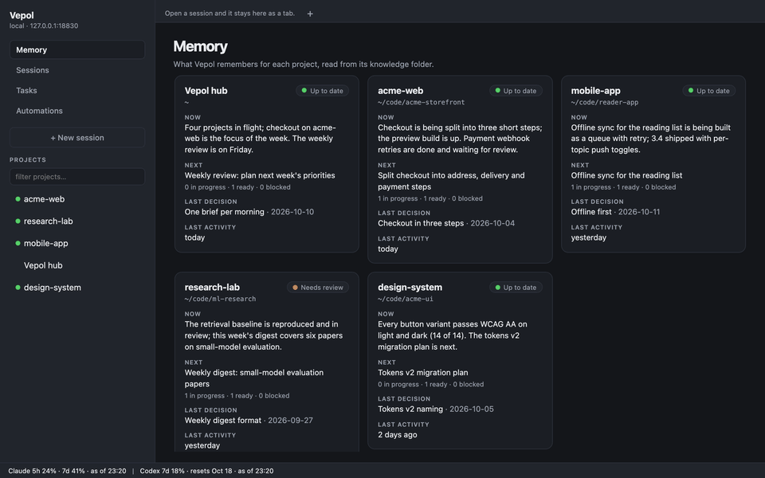
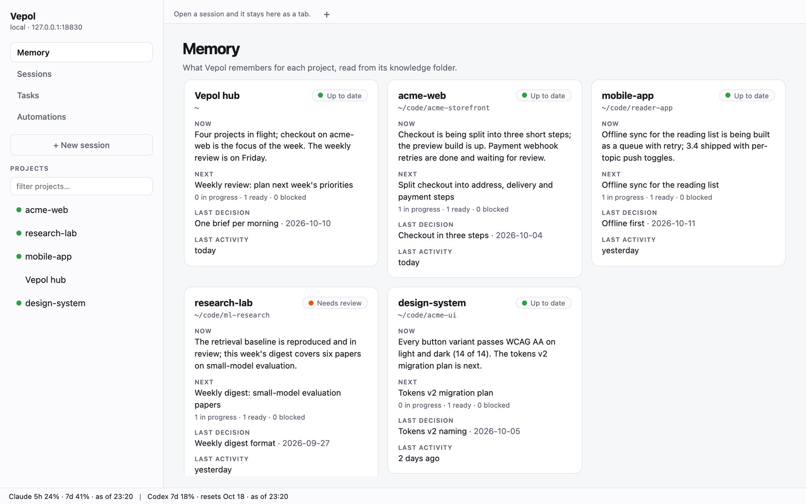
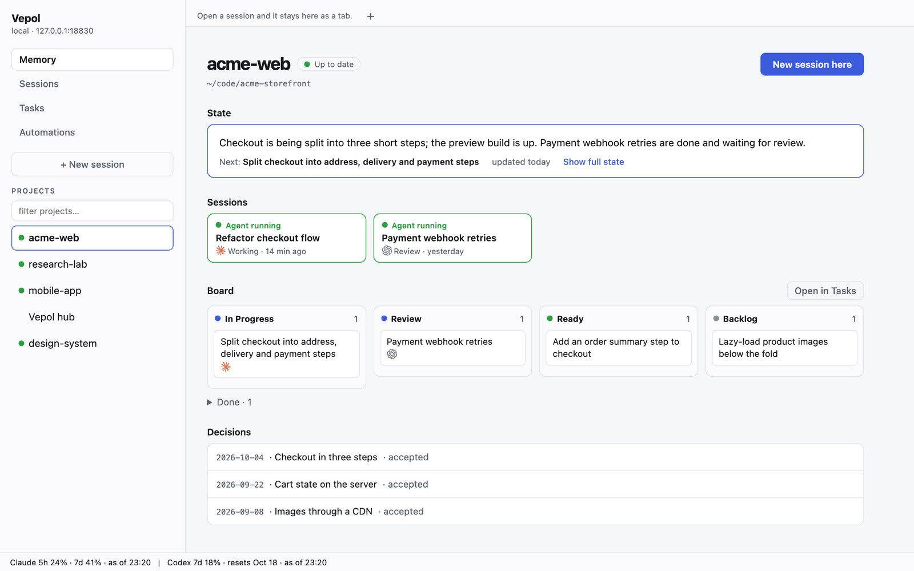
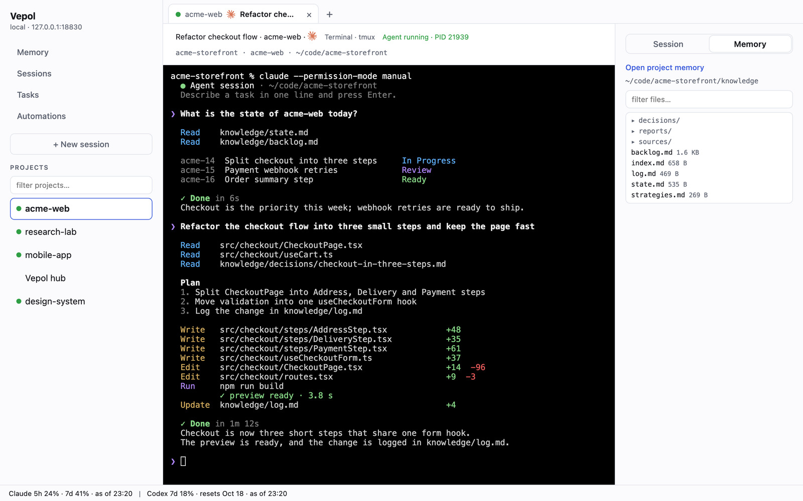
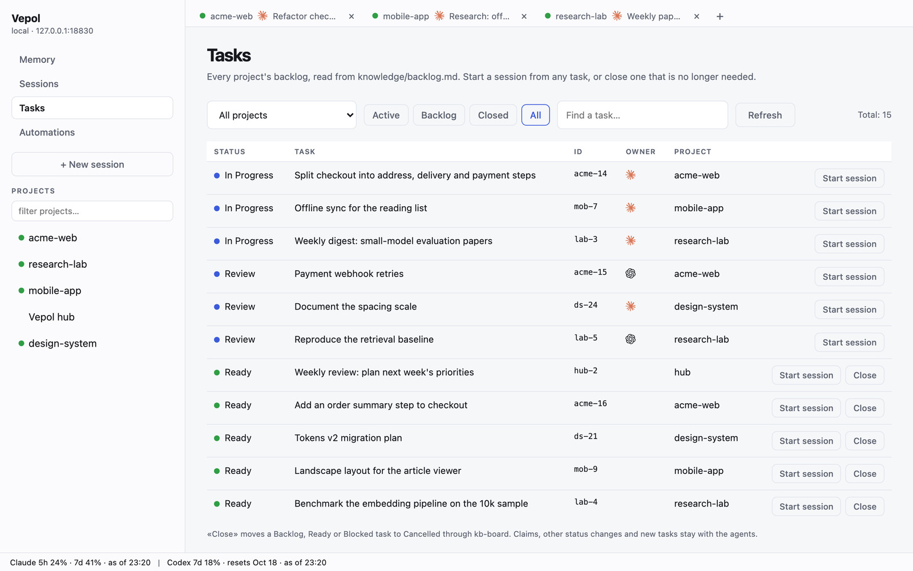
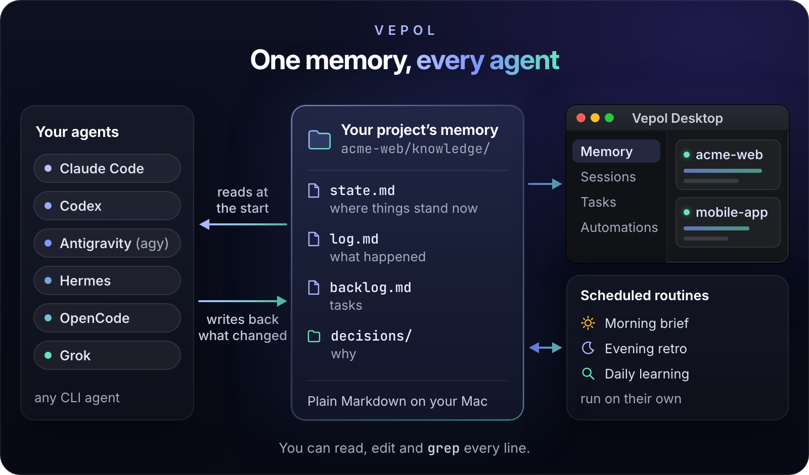
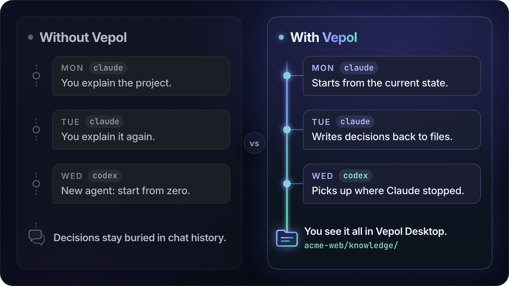

<h1 align="center">Vepol — your second inner voice</h1>

<p align="center">
  
  <br><sub>The cover also shows where Vepol is heading: autonomy that grows stage by stage, agents that review each other's work and a strategy that updates itself. <a href="#what-runs-today">What runs today</a> says what ships now.</sub>
</p>

<p align="center"><b>A personal AI assistant that lives on your Mac.</b><br>
It remembers every project, plans your day and runs your daily routine through the AI agents you already use. It writes everything down in plain Markdown that stays yours.</p>

<p align="center">
  <a href="LICENSE"></a>
  <a href="https://github.com/nahornyi-ai-lab/vepol/releases/latest"></a>
  
  <a href="https://github.com/nahornyi-ai-lab/vepol/actions/workflows/tests.yml"></a>
</p>

You already work with Claude Code or Codex. Each new session starts without knowing where your project stands, last week's decisions sit in old chats, and nothing happens until you type a prompt. Vepol fixes all three.

- **It remembers.** Every project keeps one memory that all your agents start from and write back to.
- **It runs your day.** A one-minute brief each morning, a plan you agree on, a retro each evening.
- **It stays yours.** Plain Markdown on your Mac, any agent vendor, every run on record.

Vepol is for people who run several projects at once with a terminal agent. It is not a hosted service: everything runs on your Mac.

## A day with Vepol (1:42)

https://github.com/user-attachments/assets/67d66222-6b72-45f4-b2d2-3746f6f7ad2b

## What it does for you

Each item ends with what it takes. *Turn on at install* means answering yes to **Install scheduled tasks?**.

### It remembers

- **One memory every agent shares.** Each project keeps a `knowledge/` folder of plain Markdown: where things stand, what happened, what you decided and why, what comes next. Claude Code loads it at the start of every session; Codex and other agents load it because the project's `AGENTS.md` tells them to. Each agent writes back, so the next session, with any agent, picks up where the last one stopped. *Works after install.*
- **Sessions that leave notes.** With session capture on, each Claude Code session leaves a dated summary of its decisions and lessons in the project's `knowledge/daily/`. *Turn on at install (its own question); needs `uv`.*
- **Search and tasks.** `kb-search` finds any word across every project, brief and report. `kb-task` puts a task on a Markdown board that every agent shares. *Works after install.*

### It runs your day

Once scheduled tasks are on and your Telegram bot is set up ([how](#get-the-brief-in-telegram)), the brief, the retro and the digests arrive on their own, in your language.

- **A morning brief.** A one-minute read on your phone: the focus of the day, a timed plan around today's meetings, one to three actions with a clear "done when", every new email in one line with whether it needs a reply (up to 25 threads a check), ready ideas, what changed, risks and the decisions only you can make. Vepol only reads your mail; it never drafts, sends, labels or deletes anything. *Turn on at install. Meetings need Google Calendar in Claude Code; mail needs Codex with its Gmail plugin.*
- **How you slept.** If your own sync writes a small JSON file each morning (a Garmin sync works this way), the brief opens with last night's sleep, HRV against your baseline, resting pulse and energy at wake, and one suggestion: train, rest or go to bed earlier. Vepol reads the file, not the watch. *Needs your own source ([how](docs/health-in-the-brief.md)).*
- **Plan my day.** In Vepol Desktop, **Plan my day** opens the agent you pick on today's brief, your goals and your calendar. You shape the plan in plain words, and each change is saved as a new version. Only when you ask does it write the agreed blocks to Google Calendar; a clash stops the write, and it reads the calendar back to report what is there. *In Vepol Desktop; the calendar step needs Google Calendar in Claude Code.*
- **An evening retro.** What actually closed today (from your logs, not the plan), what is waiting, which emails still need a reply, how the day matched the morning plan, and one question before sleep. The brief and the retro share one file per day in `~/knowledge/briefs/`. *Turn on at install.*
- **Audio digests.** Each morning Vepol joins the brief, the arXiv review and Money Radar (when it is on) into one text without rewriting it; each evening, the retro. NotebookLM turns it into an Audio Overview in your account, or a local Qwen voice reads it on your Mac and sends the MP3 to Telegram. *Turn on at install. Needs `notebooklm login`, or the local voice (Apple Silicon, `uv`, `ffmpeg`, about 10 GiB free).*

### It keeps you sharp

- **New papers, explained.** Right after the brief, up to three new arXiv papers on AI agents. Vepol reads each one in full when `pdftotext` is installed (the abstract otherwise) and explains it in your language: why it was picked, what was studied, how, and what was found. One Telegram message per paper. *Turn on at install.*
- **Research on demand.** `kb-daily-research --text-only` sends a list of fresh AI-agent links to Telegram. Plain `kb-daily-research` builds a NotebookLM notebook with a short audio recap. `--set-topic "..."` pins your own topic. *Switch on when you want it: run it by hand, or add the link list to the daily schedule.*
- **Money Radar.** A daily scout for paying opportunities grounded in real complaints. Codex, Claude Code, Grok and Antigravity search the web in parallel, read-only; any you do not have is skipped. Vepol ranks their finds by a fixed formula and sends the best one or two to Telegram, with the money flow, rough numbers and proof links. *Switch on when you want it ([how](docs/daily-routine.md#money-radar)).*

### It keeps people and ideas

- **People.** One card per person (`kb-contact add "Name"`), with what you discussed and when to follow up. Switch on reminders to get the day's follow-ups in Telegram. Switch on proposals, and Vepol suggests new people from your mail, calendar and private Telegram chats for you to approve with a tap. *Cards work after install, with the Python packages. Reminders and proposals: switch on when you want them.*
- **Ideas.** `kb-idea capture "..."` turns a passing thought into a card in seconds. Triage it, park it, or promote it to a task or, once you approve, a calendar block. Ready ideas show up in your morning brief. *Works after install, with the Python packages.*

### One window for all of it

- **Vepol Desktop.** A Mac app with every project's memory, a Today card with Plan my day, a board of your sessions, every task across projects and every routine with its last run, next run and why it failed. Claude Code, Codex, Antigravity, Hermes, OpenCode or Grok run in real terminals inside it and keep running when you quit; the app shows the `tmux attach` command that picks one up in Terminal.app. *Works once you build it on an Apple Silicon Mac ([how](#vepol-desktop)).*

### It stays yours

- **Your Mac, your Markdown.** Everything Vepol knows is plain text you can read, edit, `grep` and keep in git. Vepol runs no cloud service of its own.
- **Any agent, no lock-in.** Claude Code is the one agent the installer needs. Codex and other agents work over the same memory, and the brief and the retro fall back from Codex to Claude Code on their own.
- **A record of everything.** Each brief is saved before it is sent, every routine writes a log, and agents note what they did in each project's `log.md`.

In depth: [Features](docs/features.md) for every feature and what it needs, [Your daily routine](docs/daily-routine.md) for everything that runs on a schedule.

## See it

<p align="center">
  
</p>

Screens from Vepol Desktop on an invented workspace.

<picture>
  <source media="(prefers-color-scheme: dark)" srcset="docs/readme/memory-dark.jpg">
  
</picture>

**Memory.** Every project on one screen: what is happening now, what is next, the last decision and the last activity.

<picture>
  <source media="(prefers-color-scheme: dark)" srcset="docs/readme/project-dark.jpg">
  
</picture>

**A project.** Its current state, its agent sessions and its task board together.

<picture>
  <source media="(prefers-color-scheme: dark)" srcset="docs/readme/terminal-dark.jpg">
  
</picture>

**An agent session.** Claude Code, Codex, Antigravity, Hermes, OpenCode or Grok in a real terminal inside the app.

<picture>
  <source media="(prefers-color-scheme: dark)" srcset="docs/readme/tasks-dark.jpg">
  
</picture>

**Tasks.** Every project's tasks in one table. Start an agent session from any of them, or close one you no longer need.

## How it works



- **A `knowledge/` folder in each project.** `state.md` says where things stand, `log.md` what happened, `backlog.md` holds the tasks, `escalations.md` what waits for you and `incidents.md` the lessons learned. `decisions/` appears with the first recorded decision. The folder sits next to your code and is added to the project's `.gitignore`.
- **One hub, `~/knowledge`.** It links every project's `knowledge/` and keeps what spans them: briefs, reports, people, ideas and your settings.
- **Every session starts from it.** In Claude Code, a start-of-session hook (a command Claude Code runs as each session opens) loads the project's state, recent log, open tasks, open escalations and the rules learned from past incidents. Codex and other agents get the same context from `kb-session-start --print --cwd "$PWD"`, as the project's `AGENTS.md` tells them. Agents write results, decisions and lessons back.
- **Routines run over it.** Once scheduled tasks are on, a macOS LaunchAgent (a background job) runs `kb-tick` every 15 minutes. It runs whatever is due in `~/knowledge/personal/processes.yaml`: each step at most once a day, retried on the next check if it fails, and logged.
- **Failover.** The brief and the retro try Codex first and hand the job to Claude Code when Codex is rate-limited, logged out, offline, missing or returns nothing. Each brief is saved before it is sent and tracked part by part, so a crash never loses it or sends it twice.

## Why not just a chat



| | A typical agent chat | Vepol |
|---|---|---|
| **Where memory lives** | inside one tool, in that tool's format | plain Markdown in each project's `knowledge/`, which you can read, edit and `grep` |
| **A new session** | starts blank, or from whatever you paste in | starts from the project's state, recent log and open tasks |
| **Switching agents** | the new agent starts from zero | Claude Code, Codex and others read the same folder |
| **Decisions and lessons** | scroll away in chat history | written to the project's log, `decisions/` and `incidents.md` |
| **Tasks** | in your head or a separate tracker | in `backlog.md`, one board every agent shares |
| **Your day** | waits for your prompt | the brief, the retro and the digests arrive on schedule once you turn them on |
| **A provider goes down** | you wait | the brief and the retro arrive if either Codex or Claude Code answers |

Already keep a `CLAUDE.md` or `AGENTS.md`? Vepol builds on them. Those files tell an agent how to work; `knowledge/` tells it where the project stands today.

## Install

You need macOS 13 or later, Claude Code (the `claude` command-line tool, not the desktop app), `git`, `ripgrep`, Python 3.10+ and bash 5+ (macOS ships 3.2). The installer checks them and prints the exact command for anything missing. It never installs a package manager or uses `sudo`, and `./install.sh --help` lists the optional tools and what each enables. If you already have a `~/knowledge` folder from another tool, back it up first.

**A) Let your agent install it.** Copy the prompt from [`SETUP.prompt.md`](SETUP.prompt.md) into Claude Code or Codex. The agent looks at your Mac without changing anything, shows you a plan, asks which extras you want, runs the installer, checks the result and reads you the install receipt. Details: [Getting started](docs/getting-started.md).

**B) By hand:**

```bash
git clone https://github.com/nahornyi-ai-lab/vepol ~/vepol
cd ~/vepol
./install.sh
```

The installer creates the hub at `~/knowledge`, links the `kb-*` commands into `~/knowledge/bin`, installs three Claude Code skills (`/init-kb` among them) and adds a short managed block to `~/.claude/CLAUDE.md`, keeping your own text. It creates `~/.claude/settings.json` only if you have none. Every optional part is a question that defaults to no. Say yes to **Install scheduled tasks?** for the daily routine.

### After install

The installer does not change your `PATH`. Add Vepol's commands, install the Python packages, then check the install and try it:

```bash
export PATH="$HOME/knowledge/bin:$PATH"                     # this terminal
echo 'export PATH="$HOME/knowledge/bin:$PATH"' >> ~/.zshrc  # every new terminal
python3 -m pip install --user -r ~/vepol/requirements.txt   # people and ideas

kb-doctor install-health   # checks commands, hooks, scheduled tasks, tools and Python packages
kb-task "My first task"    # puts a task on the hub's board
kb-search "first task"     # finds it again
kb-demo brief              # a sample brief from an invented hub; calls a model, sends nothing
```

If pip answers `externally-managed-environment` (Homebrew's Python does), run `python3 -m pip install --break-system-packages -r ~/vepol/requirements.txt` instead. The `kb-*` commands use the `python3` on your `PATH`, so packages in a separate virtual environment are not seen.

For the default NotebookLM audio, install its command with `pipx install notebooklm-py && notebooklm login` (`pipx` comes from `brew install pipx`; run `pipx ensurepath` once and open a new terminal). pipx puts `notebooklm` in `~/.local/bin`, where scheduled routines look for it; a `pip --user` install can put it in a folder they never search.

**Give a project its memory.** Open Claude Code in the project's folder and type `/init-kb`:

```bash
cd path/to/your-project
claude          # then type /init-kb at the prompt
```

Claude looks at the project, proposes a name, a category and a description, and asks before writing anything. Then it creates `knowledge/` and links it into `~/knowledge`. In Vepol Desktop, **Add project…** in the New session dialog does the same in one step, without the questions.

**Had a `~/.claude/settings.json` before?** Claude Code loads the memory only once Vepol's session hooks are in it. The installer offers to add them, and you can check and add them any time:

```bash
kb-claude-hooks --check    # exit 0: all three hooks are there; 1: names the missing ones
kb-claude-hooks --apply    # backs up settings.json, then adds only the missing hooks
```

To remove Vepol, run `./uninstall.sh` in `~/vepol` (`--dry-run` lists what it would remove first). It keeps your `~/knowledge`.

### Get the brief in Telegram

The brief, the retro and the digests come through a Telegram bot you create. Until it is set up, each one is still saved under `~/knowledge`, just not sent.

1. Create a bot with [@BotFather](https://t.me/BotFather) and copy its token.
2. Send your new bot any message. Then open `https://api.telegram.org/bot<token>/getUpdates` in a browser, with your token in place of `<token>`, and copy the number after `"chat":{"id":`.
3. Put both values in `~/knowledge/personal/.secrets`, which the installer created and only you can read:

   ```text
   TELEGRAM_BOT_TOKEN=<token from BotFather>
   TELEGRAM_CHAT_ID=<your chat id>
   ```

4. Test it with `kb-channel-send test "Hello from Vepol"`. Exit code 0 means Telegram accepted it, 3 means a value is still empty, and 4 means the send failed: check the token, and that you messaged the bot first.

If today's brief was saved before Telegram was ready, `kb-brief` sends the saved copy without a new model call. Give Claude Code's own Telegram plugin a different bot: two programs reading one bot take each other's messages. Mail, calendar, health, audio and Money Radar: [Your daily routine](docs/daily-routine.md).

### Vepol Desktop

Vepol Desktop needs an Apple Silicon Mac, Apple's Command Line Tools, Python 3.11 or later and `tmux`. The installer does not build it; you build it once from the clone:

```bash
xcode-select --install                      # Command Line Tools; skip if you have them
brew install python tmux                    # Python 3.11+ and tmux
cd ~/vepol/face
"$(brew --prefix)/bin/python3" -m venv .venv
.venv/bin/python --version                  # must print 3.11 or later
.venv/bin/pip install -r requirements.txt
./desktop/build.sh
open desktop/build/VepolDesktop.app
```

The build uses the standalone Command Line Tools, so Xcode alone is not enough. Name the Python as above, because a plain `python3` may be Apple's 3.9. The app runs from this clone and its `.venv`, so keep both in place. It listens only on `127.0.0.1`. Full guide: [Vepol Desktop](face/README.md).

To look around first, run `./demo.sh` from `face/` after the build. It opens the app on an invented company with three projects, in a fresh copy that never touches your `~/knowledge`.

## Status

**Vepol 1.2.0** (2026-11-27) is the latest release. A fresh clone gives you `main`, the branch new work lands on. Right after a release, `main` holds the same code as that release; it moves ahead only when new work lands, and the [changelog](CHANGELOG.md) notes every change. What 1.2.0 brings and what changes for an existing install: [release notes](docs/releases/v1.2.0.md).

- **Updating.** `./upgrade.sh` follows release tags: it moves you to the newest release and re-runs the installer, keeping the extras you already have. If you track `main` instead, update with `git pull` and re-run `./install.sh`.
- **Stable core.** The knowledge folder layout, the `kb-board` task board (its file format and commands) and install and upgrade change incompatibly only in a new major version. Other `kb-*` commands and the `processes.yaml` settings may change within 1.x, and the changelog notes every such change.
- **macOS only.** macOS 13 or later. Vepol Desktop needs Apple Silicon, is built from source and is not notarized or packaged.

### What runs today

| Status | What |
|---|---|
| **Works after install** | Shared memory and the hub, startup context in Claude Code, `kb-search`, the task board, ideas and people cards (with the Python packages), `kb-demo`, `kb-doctor`, upgrade and uninstall |
| **Turn on at install** | Morning brief, evening retro, mail summaries, the arXiv digest, morning and evening audio digests, and the nightly `state.md` refresh (after a one-time `kb-rebuild-registry bootstrap` and `apply`). Session capture is its own question and needs `uv` |
| **Needs your account or source** | A Telegram bot, Gmail through Codex's Gmail plugin, Google Calendar in Claude Code, `notebooklm login` or the local Qwen voice for audio, a daily health file from your own sync, Codex for failover and second opinions |
| **Works once you build it** | Vepol Desktop, with Plan my day |
| **Switch on when you want it** | Money Radar, people proposals, follow-up reminders, daily research on a schedule |
| **Experimental** | The multi-project nightly cycle and its plan dispatch, the task auto-executor (`kb-execute-next`), the self-improvement helpers (`kb-evolution`), the multi-bot Telegram runtime, and chatting with a live Claude Code session from Telegram. All need setup by hand and may change |
| **Direction** | Earned autonomy, cross-agent review as an automatic gate, a strategy that updates itself, health that sets the day's intensity, Pro modules ([below](#where-vepol-is-heading)) |

## Where Vepol is heading

> **Direction, not today's product.** The picture shows the plan. The list says what of it exists today.


- **Autonomy that is earned.** The plan: every kind of task starts supervised, with Vepol drafting and you editing, and runs on its own once your edits approach zero. Today nothing measures your edits; what runs unattended is the fixed set of routines in `processes.yaml`.
- **Cross-agent review as a gate.** Today it is a working rule your agents follow: for non-trivial work, write a short spec and have one other agent check it once before you approve. No code starts the reviewer or holds work until it answers.
- **A strategy that updates itself.** Today each project's `strategies.md` is a page you and your agents edit by hand.
- **Health that sets the pace.** Today the brief turns your health file into one suggestion for the day. It does not lighten your plan on its own.
- **Pro modules** are planned. None ship today.

Of the picture, mail sorting and the plain-text audit trail (`log.md`, `escalations.md`) work today. Vepol never drafts or sends email, and the 50% figure and the health brake are illustrations, not measurements.

Your feedback shapes what comes next: [open an issue](https://github.com/nahornyi-ai-lab/vepol/issues).

## Docs

- [Features](docs/features.md): every feature, what it needs and how to turn it on
- [Your daily routine](docs/daily-routine.md): the brief, the retro, the digests, Telegram, mail, calendar and Money Radar
- [Getting started](docs/getting-started.md): install and first steps, in detail
- [Health in the brief](docs/health-in-the-brief.md): the daily health file and its format
- [Vepol Desktop](face/README.md): build, screens, terminals and the demo
- [People](docs/modules/people.md) and [Idea intake](docs/modules/idea-intake.md)
- [What is Vepol](docs/what-is-vepol.md): the longer "is this for me?" page
- [Security and privacy](docs/security-and-privacy.md) and [dependencies](docs/dependency-matrix.md)
- [Methodology](docs/methodology/): how agents work with the knowledge base
- [Changelog](CHANGELOG.md)

## License

[FSL-1.1-MIT](LICENSE): source-available now, and each release becomes MIT two years after it is published.

- **Allowed:** personal use, use inside your company, services to clients with Vepol, modifications, non-competing forks and redistribution.
- **Needs a commercial license:** a hosted service that competes with Vepol, or reselling Vepol under another brand.

Details and edge cases: [LICENSE-FUTURE.md](LICENSE-FUTURE.md) and [COMMERCIAL.md](COMMERCIAL.md).

## Funding

If Vepol saves you time, consider sponsoring:

[](https://github.com/sponsors/nahornyi-ai-lab)

- **$5/mo** — Supporter (helps cover infrastructure costs)
- **$15/mo** — Advanced (early access to Pro module betas)
- **$50/mo** — Priority (we triage your issues first)
- **$250/mo** — Backer (your logo in this README)

Or do nothing: the software is yours to use either way.

## Contributing

Bug reports, fixes, docs and ideas are welcome. [CONTRIBUTING.md](CONTRIBUTING.md) covers the development setup, the tests and how we work: a short spec before any non-trivial change, and one lightweight independent review of that spec before the code starts. For a non-trivial change, open an issue first. Please follow the [Code of Conduct](CODE_OF_CONDUCT.md). Report security problems through [SECURITY.md](SECURITY.md), not a public issue.

## Acknowledgments

- **Andrej Karpathy**, for the [LLM Wiki gist](https://gist.github.com/karpathy/442a6bf555914893e9891c11519de94f) that gave Vepol its starting pattern.
- **Genrich Altshuller**, for TRIZ. A "vepol" is TRIZ's substance-field: here, you, your agents and the field of notes that binds them.
- **Sentry**, for [FSL](https://fsl.software/), a license that is fair to users now and opens up fully later.
- **Anthropic, OpenAI and Google**, for Claude Code, Codex and the Antigravity CLI, the agents Vepol works through.
- The open-source projects Vepol builds on: [claude-memory-compiler](https://github.com/coleam00/claude-memory-compiler) for session capture, and notebooklm-py and mlx-audio with Qwen3-TTS for the audio digests.

## Contact

- **Issues:** <https://github.com/nahornyi-ai-lab/vepol/issues>
- **Email:** vadym@nahornyi.ai
- **Security:** see [SECURITY.md](SECURITY.md)
- **Commercial license:** see [COMMERCIAL.md](COMMERCIAL.md)
- **Organization:** <https://github.com/nahornyi-ai-lab>
