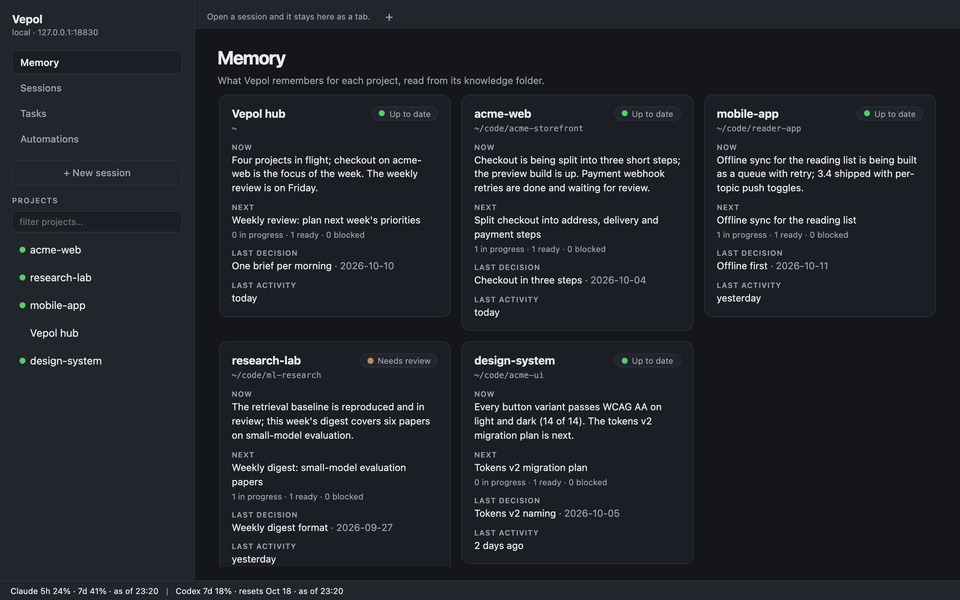
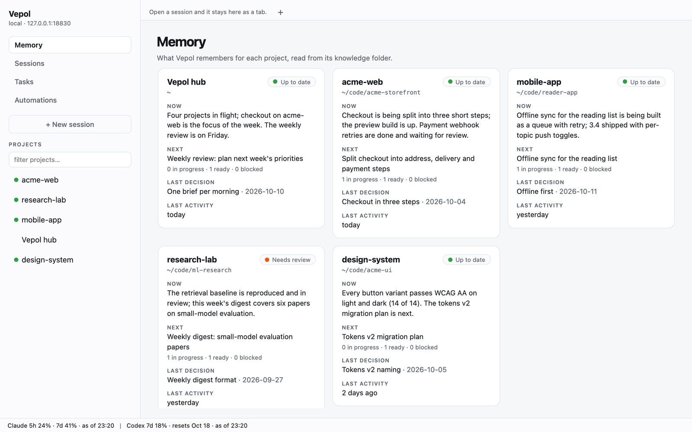
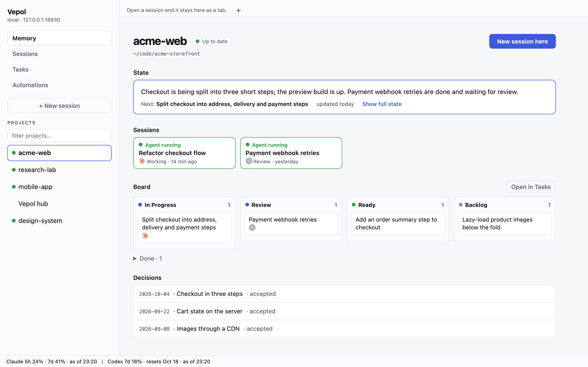
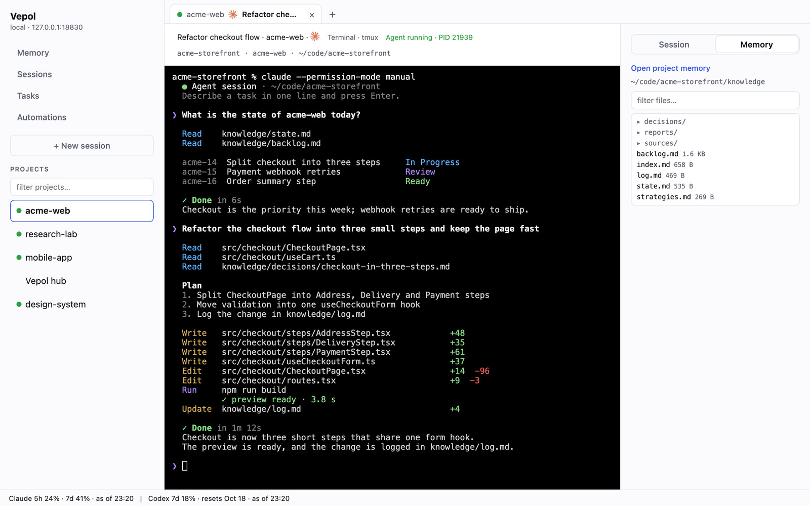
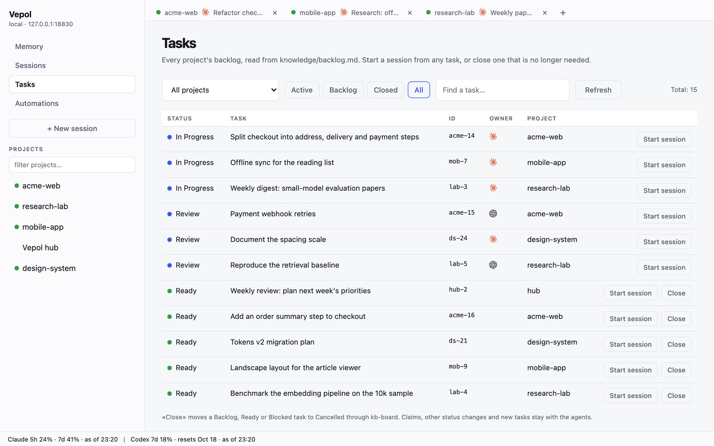
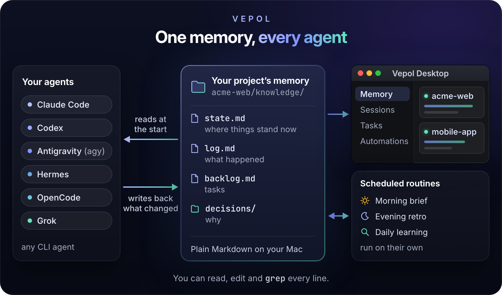
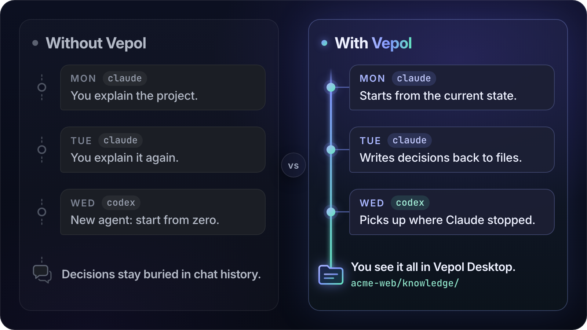

<h1 align="center">Vepol — your second inner voice</h1>

<p align="center">
  
  <br><sub>The autonomy stages and the self-updating strategy on the cover show where Vepol is heading; <a href="#grows-with-you">Grows with you</a> says what runs today.</sub>
</p>

<p align="center"><b>Your personal AI assistant that grows with you.</b><br>
A digital twin of your work: it knows your projects, plans your day, runs your routine and is built to take on more of it over time — while you stay in control of every step.</p>

<p align="center">
  <a href="LICENSE"></a>
  <a href="https://github.com/nahornyi-ai-lab/vepol/releases/latest"></a>
  
</p>

## What it is

Most AI tools wait for you to ask. They forget what you did yesterday, they do not know what matters to you this week, and every new chat starts from zero.

Vepol works the other way round. It is a personal assistant that lives on your Mac and works alongside you. It keeps a living picture of your work — every project, where it stands, what you decided and why, what comes next — and uses it to plan your day and run your routine; taking on more of your work over time is where it is heading. Think of it as a digital twin of your work: with the optional session capture it learns how you work, and you decide how far it goes.

It runs on the AI agents you already use — Claude Code, Codex and others — so you are never tied to one vendor. Everything it knows is plain Markdown on your Mac that you can read, edit and search. Vepol is source-available under FSL-1.1-MIT.

## What it does for you

- **Plans your day.** Each morning a short brief: your focus, the main actions, what changed and what needs your decision. ([more](docs/features.md#what-it-does-for-you))
- **Runs your routine.** The morning brief, the evening retro and a daily learning digest on AI agents run on schedule, without a prompt, once you turn on scheduled routines at install; follow-up reminders can be switched on in `processes.yaml`. ([more](docs/features.md#background-processes-runtime))
- **Remembers your work.** Each project keeps where it stands, what happened and why it was decided, so every agent you open starts from there, not from zero. ([how](#how-it-works))
- **Catches your ideas.** `kb-idea` turns a passing thought into a card you can triage, park or promote to a task. ([more](docs/features.md#idea-intake))
- **Remembers people.** One card per person you work with, with follow-up reminders you can switch on. ([more](docs/features.md#people))
- **Learns how you work** *(with the optional session capture)*. Decisions, lessons and patterns from each session feed the next plan. ([more](docs/features.md#what-it-does-for-you))
- **Shows you everything in one app.** Vepol Desktop: your memory, every project, your agents in a real terminal, every task and routine. ([more](docs/features.md#vepol-desktop))
- **Looks after your health and goals** *(in progress)*. Today the brief can show sleep and health from a daily file you supply; device data and lighter plans after bad nights come next. ([more](docs/health-in-the-brief.md))

## Watch: a day with Vepol (1:42)

https://github.com/user-attachments/assets/67d66222-6b72-45f4-b2d2-3746f6f7ad2b

## Grows with you


Vepol is built to take on more of your work over time. Every kind of task starts supervised: Vepol drafts, you edit. Where your edits approach zero, that kind of task graduates to running on its own; where you keep correcting, it stays supervised. Every meaningful action leaves a dated line in plain text that you can read and edit.

Where it is today: once you turn on scheduled routines at install, the daily routine (morning brief, evening retro, learning digest) runs on its own, and every run is logged; follow-up reminders join it when you switch them on. The picture shows the direction, not today's product: graduating other kinds of tasks one by one, the health brake from device data and the figures in it are not shipped yet.

## See it

<p align="center">
  
</p>

Screenshots from Vepol Desktop on an invented demo workspace.

<picture>
  <source media="(prefers-color-scheme: dark)" srcset="docs/readme/memory-dark.jpg">
  
</picture>

**Memory** — every project on one screen: what is happening now, what is next, the last decision and the last activity.

<picture>
  <source media="(prefers-color-scheme: dark)" srcset="docs/readme/project-dark.jpg">
  
</picture>

**A project** — its current state, its agent sessions and its task board together.

<picture>
  <source media="(prefers-color-scheme: dark)" srcset="docs/readme/terminal-dark.jpg">
  
</picture>

**An agent session** — Claude Code, Codex, Antigravity, Hermes, OpenCode or Grok in a real terminal inside the app.

<picture>
  <source media="(prefers-color-scheme: dark)" srcset="docs/readme/tasks-dark.jpg">
  
</picture>

**Tasks** — every project's tasks in one table; start an agent session from any of them.

## How it works

**Your agents forget. Vepol remembers.** Under the hood, your assistant runs on one shared memory that every agent reads and writes.



- **One folder per project.** `knowledge/` holds `state.md` (where things stand), `log.md` (what happened), `backlog.md` (tasks) and `decisions/`. One central folder, `~/knowledge/` (the hub), links every project and holds what is not tied to one project.
- **Every agent starts from it.** The project's `AGENTS.md` tells whichever agent you open to read these files first and write its results back; Claude Code gets them loaded by a start-of-session hook (the installer adds it to a new `settings.json`; the agent install offers to merge it into an existing one).
- **The next session continues.** Decisions, results and lessons are written back to the log and the state, so the next agent — of any vendor — picks up where the last one stopped.
- **You see it, routines use it.** Vepol Desktop opens on that memory; if you turn on scheduled tasks at install, routines such as the morning brief and the evening retro read and write the same files on their own.

## Why not just a chat



| | Typical agent chat | Vepol |
|---|---|---|
| **Memory** | hosted by the vendor, opaque to you | your text files, you can edit them |
| **Context across sessions** | usually lost or summarized | survives — the agent reads the files each time |
| **Switching agents** | a new agent starts from zero | Claude Code, Codex and others share the same folder |
| **Decisions and lessons** | dissolve in chat history | written back to the project's log and decisions |
| **Tasks** | in your head or an external tracker | in `backlog.md`, a board every agent shares |
| **Routine** | waits for your prompt | scheduled routines run without one |

Already keep a `CLAUDE.md` or `AGENTS.md`? Vepol builds on them: those files tell an agent how to work, the `knowledge/` folder tells it where the project stands today, and every agent keeps that folder current.

## Install

**A) Let your agent install it.** Copy the prompt from [`SETUP.prompt.md`](SETUP.prompt.md) into Claude Code or Codex. The agent looks at your machine without changing anything, shows you a plan, asks before every step, runs the installer, verifies and reads you back a receipt. Details: [`docs/getting-started.md`](docs/getting-started.md).

**B) By hand:**

```bash
git clone https://github.com/nahornyi-ai-lab/vepol ~/vepol
cd ~/vepol
./install.sh
```

The installer checks what you have and prints the exact command for anything missing ([dependencies](docs/features.md#dependencies)); it never installs a package manager. It adds a short Vepol block to your global `~/.claude/CLAUDE.md` (your own text stays) and creates `~/.claude/settings.json` only if you have none. If you already have a `~/knowledge/` from another tool, back it up first; the agent path (A) checks for conflicts for you.

The installer does not change your `PATH`, so add Vepol's commands to it (put the first line in `~/.zshrc` to keep it), then try them:

```bash
export PATH="$HOME/knowledge/bin:$PATH"
kb-doctor              # check the install is healthy
kb-task "first task"   # write your first task
kb-search "first"      # find it again
```

Then give one of your own projects its memory: open Claude Code in that project's folder and run `/init-kb`. It proposes a `knowledge/` folder, asks before writing anything and links the project to `~/knowledge/`. In Vepol Desktop, **Add project…** in the New session dialog does the same for any folder.

### See your memory in Vepol Desktop

Vepol Desktop needs an Apple Silicon Mac, Python 3.11 or later (for example `brew install python`), the Command Line Tools and `tmux`. Build it once from the `face/` folder ([full guide](face/README.md)):

```bash
cd ~/vepol/face
python3 -m venv .venv
.venv/bin/pip install -r requirements.txt
./desktop/build.sh
open desktop/build/VepolDesktop.app
```

To look around before you point it at your own work, run `./demo.sh` from `face/` after the build: it opens the app on an invented company with three projects, in a fresh copy that never touches your `~/knowledge`.

## Status

**Vepol 1.1.1** is the latest release. `./upgrade.sh` moves an install to the newest release; a fresh clone gives you `main`, which may be ahead of it (see "Unreleased" in the [changelog](CHANGELOG.md)).

- The stable core — the knowledge folder layout, the `kb-board` task board (its file format and commands) and install/upgrade — changes incompatibly only in a new major version.
- Other `kb-*` commands and the routine settings may still change within 1.x; every such change is noted in [`CHANGELOG.md`](CHANGELOG.md).
- macOS 13+ only. Vepol Desktop runs on Apple Silicon, is built from source and is not notarized or packaged.
- Not shipped yet: data from health devices (on `main` the brief can show sleep and health only from a daily file you supply), the fully automated nightly planning cycle, and the Pro modules (cloud sync, advanced templates).

We treat your feedback as design input — open an issue.

## Docs

- [Features in depth](docs/features.md) — everything Vepol does, module by module
- [What is Vepol](docs/what-is-vepol.md) — the long-form explanation: who it is for and who it is not for
- [Getting started](docs/getting-started.md) — install and first steps in detail
- [Methodology](docs/methodology/) — how agents work with the knowledge base
- [Security and privacy](docs/security-and-privacy.md)
- [Changelog](CHANGELOG.md)

## License

[FSL-1.1-MIT](LICENSE): source-available now, and each release becomes MIT two years after its publish date.

- ✅ Personal use, internal company use, professional services to clients, modifications, forks, redistribution
- ❌ A hosted SaaS that competes with Vepol (until that release turns MIT)

Details and edge cases: [LICENSE-FUTURE.md](LICENSE-FUTURE.md) and [COMMERCIAL.md](COMMERCIAL.md).

## Funding

If Vepol saves you time, consider sponsoring:

[](https://github.com/sponsors/nahornyi-ai-lab)

- **$5/mo** — Supporter (helps cover infra costs)
- **$15/mo** — Advanced (early access to Pro module betas)
- **$50/mo** — Priority (we triage your issues first)
- **$250/mo** — Backer (logo in this README)

Or do nothing — the software is yours to use either way.

## Contributing

We accept PRs. For a non-trivial change, write a short spec before the code ([spec-driven workflow](docs/methodology/spec-driven-workflow.md)); for an architectural one, expect one independent review of that spec before implementation starts. Open an issue first if you are unsure.

## Acknowledgments

- **Andrej Karpathy** for the [LLM Wiki gist](https://gist.github.com/karpathy/442a6bf555914893e9891c11519de94f) that gave us the initial pattern
- **Genrich Altshuller** for TRIZ and the substance-field model that gives Vepol its name
- **Sentry** for [FSL](https://fsl.software/) — a license model that's commercial-friendly without being permanently restrictive
- **Anthropic, OpenAI, and Google** for Claude Code, Codex, and Antigravity CLI — ready-made agents Vepol can coordinate

## Contact

- **Issues:** <https://github.com/nahornyi-ai-lab/vepol/issues>
- **Email:** vadym@nahornyi.ai
- **Security:** see [SECURITY.md](SECURITY.md)
- **Commercial license:** see [COMMERCIAL.md](COMMERCIAL.md)
- **Org:** <https://github.com/nahornyi-ai-lab>
