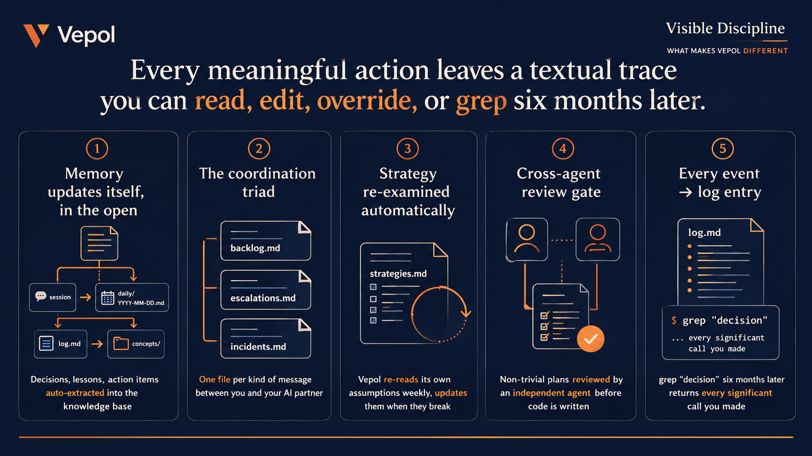
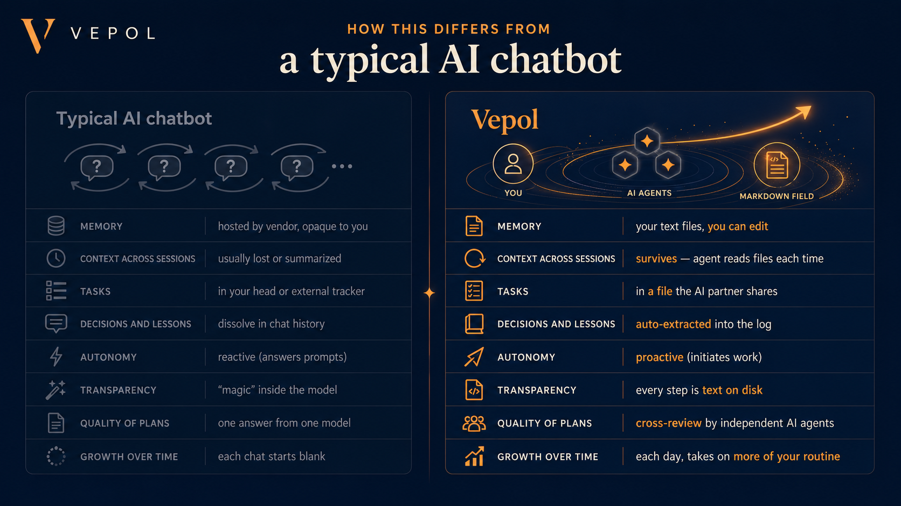
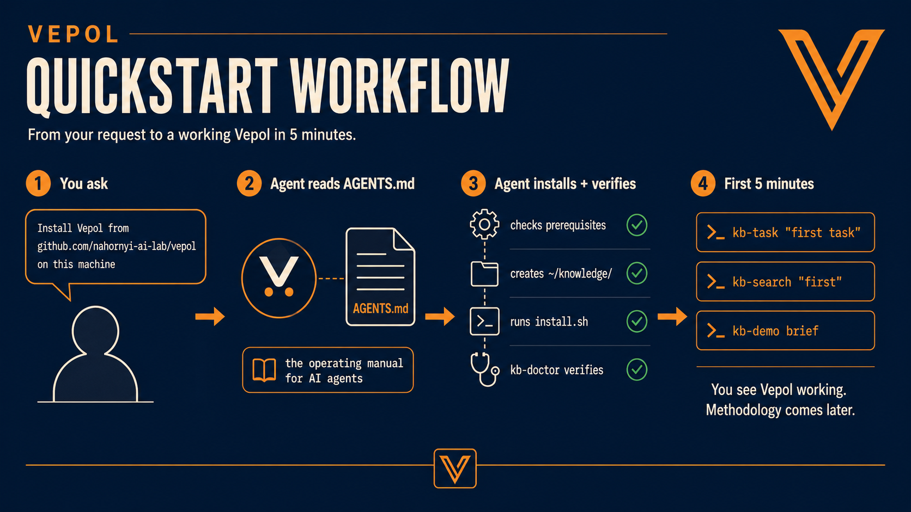
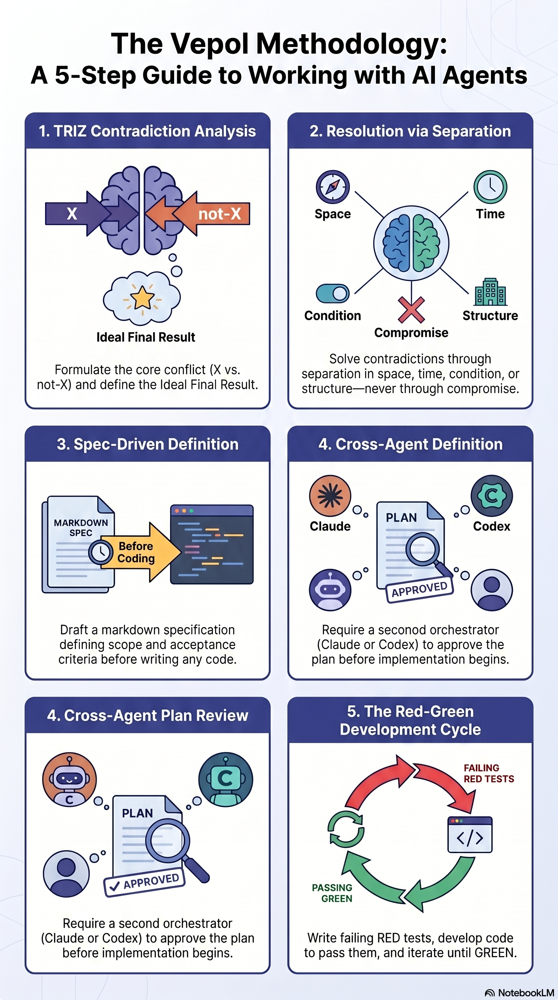

# Vepol features in depth

Everything the [README](../README.md) only names, in full: what Vepol does for you, the modules that ship,
how it differs from a chat assistant, how to get through the first five minutes, and how the pieces fit
together. The older infographics live in [`visuals/`](visuals/).

## Contents

- [Bring your own AI agent](#bring-your-own-ai-agent)
- [What it does for you](#what-it-does-for-you)
- [What's shipped](#whats-shipped)
  - [Vepol Desktop](#vepol-desktop) · [Runtime registry](#runtime-registry) ·
    [Background processes runtime](#background-processes-runtime) ·
    [Nightly knowledge refresh](#nightly-knowledge-refresh) · [Idea Intake](#idea-intake) ·
    [People](#people) · [Daily plan](#daily-plan) · [Task board](#task-board) ·
    [Daily research](#daily-research) · [Multi-bot agent runtime](#multi-bot-agent-runtime)
- [Visible discipline](#visible-discipline)
- [How this differs from other AI assistants](#how-this-differs-from-other-ai-assistants)
- [Your first five minutes](#your-first-five-minutes)
- [Morning audio routes](#morning-audio-routes)
- [Architecture in three sentences](#architecture-in-three-sentences)
- [Methodology pages](#methodology-pages)
- [Dependencies](#dependencies)

## Bring your own AI agent

Vepol is not a new foundation model and does not try to replace the
agents you already use. It is a local operating layer for **ready-made
CLI-capable AI agents**: Claude Code, Codex, Antigravity CLI, or any future
agent that can read files, run commands, and follow a written protocol.

The agent supplies the reasoning and tool use. Vepol supplies the shared
filesystem, markdown knowledge base, scheduler, lightweight spec review, logs,
incidents, backlog, and handoff rules that let those agents work as one
long-running partner instead of isolated chat sessions.

Agent-specific files such as `CLAUDE.md` are adapters: they point each
CLI agent at the same shared operating contract and KB discipline
instead of becoming separate rulebooks. Antigravity CLI (`agy`) reads
`AGENTS.md` natively via `agy --add-dir <path>` and needs no project
adapter.

This matters because you keep optionality. If one provider is rate-limited,
too expensive, weak on a task, or unavailable, another configured agent can
pick up from the same files. The source of truth is the knowledge base, not
any single model's private memory.

## What it does for you

- **Plans your day.** Each morning Vepol reads your knowledge base — open
  tasks, deadlines, what got done yesterday — and writes a short brief.
  Not "what do you want to do?" — "this is what's worth doing today,
  given what I know about your work."
- **Captures ideas before they disappear.** When an idea arrives in chat,
  dictation, or a future voice adapter, Vepol can write it into a structured
  idea card immediately. Captured does not mean committed: the idea can be
  triaged, critiqued, parked, killed, promoted into the task board, or proposed
  as a calendar block only after approval.
- **Keeps you current on AI agents.** Each morning a learning digest
  picks up to three new arXiv papers on AI agents and explains them in
  your language; it arrives as text in your channel. Run
  `kb-daily-research` for a one-topic deep dive whenever you want one:
  by default it runs a curated radar over the AI-agent space, or you
  can pin any topic — including one from your active project. When you
  want depth, its NotebookLM mode turns the research into a notebook
  with an audio recap in your language.
- **Runs your routine in the background.** Scheduled routines — the
  morning brief, evening retro, learning digest, follow-up
  reminders — are declared in `processes.yaml` and fire on schedule
  without prompting. By the time you sit down, they're done. Per-task
  background execution from the task board (`auto: true`) is being
  re-ported to the new board format and is not part of that loop yet.
- **Studies you, doesn't just store you.** With the optional session
  capture ([claude-memory-compiler](#dependencies)), Vepol extracts
  decisions, lessons, action items, and ergonomic patterns ("sharper in
  the morning," "this kind of task always blocks for two days") after
  each session, and uses them in tomorrow's plan.
- **Self-reflects and updates itself** *(in progress)*. Once a week
  Vepol re-reads its own strategy file — assumptions about how to help
  you — and rewrites it if assumptions broke. You see the diff.
- **Proactive, not reactive.** Morning brief, evening retro, mid-day
  reminders, escalations when blocked — all initiated by Vepol over
  Telegram or whatever channel you wired up.
- **Aligned with your health and goals** *(in progress)*. The design:
  data from Garmin, Apple Health, scales feeds in as a constraint on
  your day plan, not a performance metric — if sleep dropped for three
  days, the plan loses intensity. Device ingestion is being wired up
  release by release; treat this one as roadmap, not shipped. On `main`,
  the morning brief can already show sleep and health from a daily file
  you supply ([health-in-the-brief.md](health-in-the-brief.md)).
- **Takes on more of your work, task type by task type.** This is the
  most important part: **Vepol's autonomy is designed to compound.**
  Every task type starts supervised — Vepol drafts, you edit. The
  design contract: where your edits approach zero, that task type
  graduates to background execution; where you keep correcting, it
  stays supervised. Today the scheduled daily routine — morning brief,
  learning digest, follow-up reminders, evening retro — already runs
  unattended on the maintainer's production setup, with every action
  logged for review.

## What's shipped

The behaviour above is delivered through a small set of modules. Each
ships a CLI, a markdown schema agents read natively, and at minimum
unit tests. The list grows release by release; see
[`CHANGELOG.md`](../CHANGELOG.md) for per-release history.

The methodology that holds these modules together (the markdown
substrate, the orchestrator, the vendor-neutral agent interface, the
one-pass lightweight spec review, the MCP-first source-ingestion principle) is
documented under
[`docs/methodology/`](methodology/).

### Vepol Desktop

A native macOS app in [`face/`](../face/README.md). It
opens on Memory, what every project remembers, and one click on a project
shows its state, its sessions and its task board on one screen. Your agent
(Claude Code, Codex, agy, Hermes, OpenCode or Grok) runs in a real terminal
inside the window, with open sessions as tabs, next to a session board with
manual stages, every project's tasks and every scheduled routine with its
state and history. Local only; for Apple Silicon Macs, built from source with
the Command Line Tools (needs `tmux` and Python 3.11 or later — see the app's
README).

### Runtime registry

`kb-runtime-registry` shows which of your agent CLIs
can actually work right now (installed, logged in, within quota,
answering), from a fresh known-answer check; `--report` never spends quota.

### Background processes runtime

The routine processes
(daily brief, evening retro, learning digest, people extraction,
follow-up reminders, calendar pull) are declared in one
`processes.yaml` and gated through `kb-tick`. Five fields per
process — `id`, `enabled`, `when`, `run`, `outputs` — and one file
to read to see which routines run on your machine. Background runs
are text-first by default. Morning audio uses the whole finalized same-day
brief, eligible arXiv report, and Money Radar digest in that order, without a
second synthesis or compression pass. The two exact daily digest commands may
send their finalized text either to NotebookLM Audio Overview or to the
on-demand Qwen runtime followed by Telegram; other scheduled commands remain
fail-closed.
Fresh installs default to NotebookLM, while local Qwen is an explicit choice
that runs `kb-tts-install`; the model exits after each render instead of
running as a service. A missing config self-heals with safe defaults.

### Nightly knowledge refresh

New on `main` after 1.1.1, not in a release yet. `kb-consolidate` is a scheduled routine (06:30 in the
default `processes.yaml`). For each project it reads what was logged since the last pass (`log.md` and
`daily/` notes), asks the model for point edits to `state.md`, and applies only edits whose old text
matches the page exactly and whose new text cites a log or daily date. If the model fails, the page gets
a block listing the newer log headlines instead. Each run leaves a report with a diff and a backup under
`~/knowledge/.orchestrator/consolidate/`. It covers the projects listed in `~/knowledge/hierarchy.yaml`,
which `kb-rebuild-registry` writes; a fresh install has no such file yet, so the pass has nothing to do
until it exists.

### Idea Intake

An event-driven process for ideas you write or dictate:
`kb-idea capture` creates canonical markdown cards under `personal/ideas/`,
`personal/ideas.md` renders the dashboard, `kb-idea brief` feeds
ready/promoted ideas into the morning brief, and `kb-idea promote --create-task`
creates a normal markdown `kb-board` task. It is always available, but not a
periodic scheduled job.
[`docs/modules/idea-intake.md`](modules/idea-intake.md)

### People

Durable markdown card per person Vepol encounters,
with `kb-contact` (add / log / remind / search / due / show /
review-drafts), Google Calendar attendee ingestion through your
configured MCP host, and daily follow-up reminders.
[`docs/modules/people.md`](modules/people.md)

### Daily plan

`kb-orchestrator-cycle gen-plan` writes a draft
plan for tomorrow from your open backlog at the end of evening
retro. You confirm overnight; the morning dispatch turns the
approved plan into per-project work. The fully automated nightly
cycle is currently kept disabled on the maintainer's production
node pending scanner-v2 security-review evidence (context-injection
scanning); `kb-doctor` reports that reviewed-disabled state, and
the plan flow remains usable through the task board meanwhile.

### Task board

`kb-board` makes `knowledge/backlog.md` the
markdown-native task board for agents: Backlog, Ready, In Progress,
Blocked, Review, Done, and Cancelled, with ID-first claim/review/close
operations and no external database.

### Daily research

`kb-daily-research` (run on demand) researches one topic
through web research. With `--text-only` it delivers a text digest;
without it, it also generates a NotebookLM notebook and an audio
overview in your language. Topic is automatic by default (a curated radar over the
AI-agent space); pin it with
`kb-daily-research --set-topic "..."`, or return to auto-selection with
`kb-daily-research --auto-topic`. The scheduled daily item is the
learning digest (`kb-learning-arxiv` in the default `processes.yaml`):
up to three new arXiv papers on AI agents, as a short text digest in
your language.

### Multi-bot agent runtime

A Telegram-based supervisor that
gives each project agent its own bot identity while starting
compute only on demand. It routes mentions, queues work per
agent, applies loop guards (cooldown / depth / fan-out / hourly
quota), and writes durable outcomes back through the existing
project knowledge base.
[`docs/methodology/multibot-agent-runtime.md`](methodology/multibot-agent-runtime.md)

> **Self-hosting only.** The multi-bot runtime uses a Telegram
> user-account session to observe the configured group and can
> add bot accounts to it. Run it only for private groups you
> control, with consent from all participants. Treat bot tokens,
> Telegram API credentials, session files, and group chat IDs as
> secrets. Do not use this runtime to join, monitor, scrape, or
> automate groups where you lack authorization.

## Visible discipline

Most AI assistants are black boxes: model decides, output appears, you can't
audit, you can't roll back. Vepol works the opposite way.

**Every meaningful action leaves a textual trace** in your knowledge base
that you can read, edit, override, or `grep` six months later.



- **Memory updates itself, in the open.** With the optional session capture
  (claude-memory-compiler), decisions / lessons / action items get extracted
  after each session into `daily/YYYY-MM-DD.md` and one-line summaries go
  into `log.md`. A daily **lift** of important items into permanent
  categories (`concepts/`, `people/`, `companies/`, `solutions/`) is
  *in progress*; the design is that you see every lift and can object,
  edit, roll back.
- **Knowledge cross-links and grows.** Pages reference each other through
  markdown wiki-links (`[[concept]]`, `[[person]]`). As you ingest more
  material, Vepol periodically re-reads the corpus, spots recurring
  patterns, and proposes new connections — sometimes lifting a topic
  that keeps coming up into its own page, sometimes noticing that two
  pages you wrote separately are actually about the same thing. The
  graph densifies as you work; you can see it visually in Obsidian or
  any tool that reads markdown links.
- **Tasks live in three files, each with one job.**
  - `backlog.md` — what needs doing (you and Vepol both add)
  - `escalations.md` — items Vepol can't proceed without you (Vepol writes,
    you respond)
  - `incidents.md` — what broke + root cause + fix + prevention rule
    (every error becomes an artefact, not a fleeting frustration)

  This isn't a task tracker. It's a **protocol for communication** between
  you and your AI partner, with one file per kind of message.
- **Strategy gets re-examined** *(in progress)*. Each project carries `strategies.md`. Once
  a week Vepol re-reads its own log, checks which assumptions held, updates
  the file. You see the diff.
- **Plans get one independent review.** Before any non-trivial
  implementation, Vepol writes a short spec, has another configured AI
  agent check it once against the code, and proceeds after your approval.
- **Every event → log entry.** Not "I did something" in a chat — a dated
  line in `log.md`. Six months later, `grep "decision"` returns every
  significant call you made, with context.

## How this differs from other AI assistants



The full breakdown:

| | Typical AI chatbot | Vepol |
|---|---|---|
| **Memory** | hosted by vendor, opaque to you | your text files, you can edit |
| **Context across sessions** | usually lost or summarized | survives — agent reads files each time |
| **Tasks** | in your head or external tracker | in a file the AI partner shares |
| **Decisions and lessons** | dissolve in chat history | auto-extracted into the log |
| **Autonomy** | reactive (answers prompts) | proactive (initiates work) |
| **Transparency** | "magic" inside the model | every step is text on disk |
| **Quality of plans** | one answer from one model | plan gets one independent, code-aware review before you approve it |
| **Growth over time** | each chat starts blank | each day, takes on more of your routine |
| **Health/goal alignment** | absent | in progress (devices feed in as plan constraints) |

## Your first five minutes



You don't install Vepol by hand — your AI agent does. The tested
happy path today is Claude Code, or Codex on a machine where the
Claude CLI is available. Antigravity CLI and other agents can participate
as reviewers/workers once configured, because the handoff contract is
file-based. Copy the setup prompt from **[`SETUP.prompt.md`](../SETUP.prompt.md)** and paste it
to your agent. It tells the agent exactly how to install Vepol safely: look at your
machine without changing anything (`./install.sh --probe --json`), show you a plan,
ask before each step, drive the deterministic installer (`--apply`), verify, and read
you back a receipt. The agent asks before every change; you approve. From there it
stays with you — adding skills, tracking projects, and evolving Vepol to your workflow
over time. (Full details: [`docs/getting-started.md`](getting-started.md).)

If you'd rather drive the install yourself:

```bash
git clone https://github.com/nahornyi-ai-lab/vepol ~/vepol
cd ~/vepol
./install.sh
```

The installer detects what you have (Claude Code, Node, Bun, NotebookLM CLI,
optionally Codex and Antigravity CLI), reports what's missing with exact
install commands, and sets up the rest. It does **not** auto-install package
managers — that decision stays with you.

> **Heads up if you already have `~/knowledge/` or `~/.claude/`
> from another system:** the installer will not overwrite your
> data, but you should review what's there first. The agent path
> (above) handles this conflict-check automatically; if you're
> running `install.sh` manually, back up `~/knowledge/` first.
> (Installing into a non-default hub is not supported yet — the
> installer uses `~/knowledge`; `VEPOL_HUB` is honored only by the
> read-only `--probe`/`--dry-run`/`--verify` modes.)

The commands below assume `~/knowledge/bin` is on your `PATH` (see Install in the
[README](../README.md#install)). `kb-demo brief` needs a logged-in agent CLI (Claude Code or Codex) to
write the brief; without one it prints the error and the log to look at.

After install, your first 5 minutes:

```bash
kb-doctor              # verify install is healthy
kb-task "first task"   # write your first item
kb-idea capture "first idea" --source chat
kb-idea brief          # shows ready/promoted idea proposals after triage
kb-search "first"      # confirm retrieval works
kb-demo brief          # see what a synthesized brief looks like
                       # (uses the demo wiki — your real one is empty at first)
```

That's the value loop. Methodology comes after, when you want it.

## Morning audio routes

The learning digest delivers text out of the box. For morning audio, Vepol takes the
whole finalized morning brief, the whole eligible same-day arXiv report, and the
whole same-day Money Radar digest. It does not summarize those blocks again. The
same frozen source goes to both audio routes: Qwen narrates it literally, while
NotebookLM may turn it into its own non-literal Audio Overview. Choose the route:

```bash
# Audio Overview remains in NotebookLM; nothing is sent to Telegram.
kb-digest-migrate --file ~/knowledge/personal/processes.yaml --audio-backend notebooklm

# Or render locally with Qwen and send the MP3 to Telegram.
kb-tts-install
kb-digest-migrate --file ~/knowledge/personal/processes.yaml --audio-backend local_qwen
```

For Qwen, configure `TELEGRAM_BOT_TOKEN` (or `TELEGRAM_TOKEN`) plus
`TELEGRAM_CHAT_ID` in `~/knowledge/personal/.secrets`. Nothing stays running:
Qwen loads for one render, sends the MP3, and exits. For NotebookLM,
authenticate with `notebooklm login && notebooklm status`; the Audio Overview
stays there and is not downloaded. The installer exposes the same choice via
`--audio-backend notebooklm|local_qwen`; upgrades without that option preserve
the existing route. The on-demand `kb-daily-research` picks its topic
automatically; use `kb-daily-research --set-topic "..."` only when you
want to steer it.

## Architecture in three sentences

1. **Core (this repo)** is universal — schema, scripts, methodology
   docs, install lifecycle. Same for everyone.
2. **User overlay** is in your `~/knowledge/` — your registry, your
   logs, your concepts, your projects. Never publishes anywhere.
3. The boundary is mechanical: a manifest file (`.managed.yaml`) tracks
   which files belong to the repo (overwriteable on upgrade) and which
   belong to you (never touched).


For the full architectural narrative, see
[`docs/what-is-vepol.md`](what-is-vepol.md).

## Methodology pages

Vepol embeds a small set of opinions about how to work with AI agents.
These live in [`docs/methodology/`](methodology/):



- **[Development loop](methodology/development-loop.md)** — the single process any agent follows for new work (research-first → TRIZ → spec → one lightweight review → owner approval → RED/E2E → verify)
- **[Orchestrated knowledge base](methodology/orchestrated-knowledge-base.md)** — root concept (Karpathy LLM Wiki + 7 extensions)
- **[KB authoring discipline](methodology/kb-authoring-discipline.md)** — 8 rules to avoid false-canonical content
- **[KB freshness loop](methodology/kb-freshness-loop.md)** — how reads stay current
- **[TRIZ for design](methodology/triz-for-design.md)** — contradiction → ideal-final-result → separation
- **[Spec-driven workflow](methodology/spec-driven-workflow.md)** — spec → tests → code → tests → revisions
- **[Lightweight spec review](methodology/cross-agent-review.md)** — one independent code-aware pass that returns GO or at most three questions
- **[Parallel orchestrators](methodology/parallel-orchestrators.md)** — single source of truth for many agents

Read them in order if this is your first time. Skip if you just want
the tool.

## Dependencies

| Tool | Required | Why |
|---|---|---|
| macOS 13+ | Yes | launchd, paths, brew defaults |
| [Claude Code](https://docs.claude.com/en/docs/claude-code) (macOS app or CLI) | Yes | MCP/setup host and default orchestrator |
| Node 18+ | Yes | Skills runtime |
| [Bun](https://bun.sh/) 1.0+ | Yes | Performance scripts |
| git, bash 5+, ripgrep | Yes | Scripts |
| Python 3.10+ | Yes | Session-start hook and Python `kb-*` scripts (Vepol Desktop needs 3.11+) |
| [Codex](https://github.com/openai/codex) (macOS app or CLI) | Recommended | Lightweight spec review / alternate orchestrator |
| Antigravity CLI | Recommended | Third-opinion review / quorum |
| [NotebookLM CLI](https://github.com/teng-lin/notebooklm-py) | Recommended | On-demand research notebook / audio recap in your language |
| Telegram bot | Optional | Brief / retro channel |
| [claude-memory-compiler](https://github.com/coleam00/claude-memory-compiler) | Optional | Auto-capture sessions |

The installer checks all of these and tells you exactly what to install.
