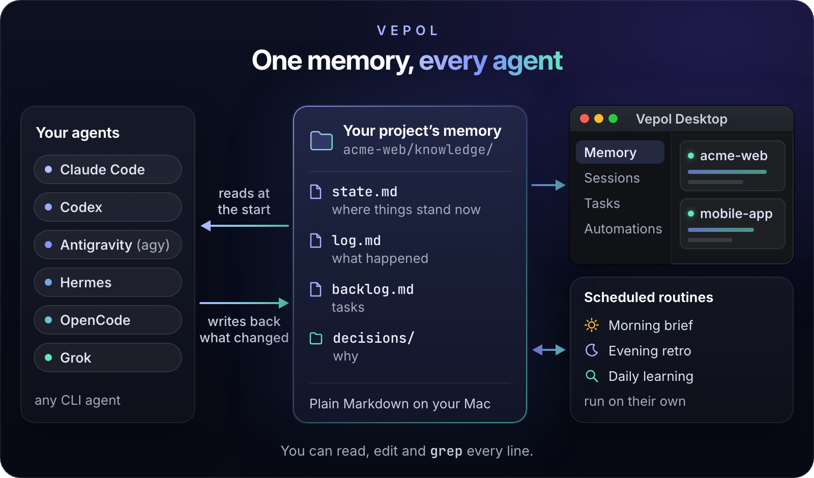
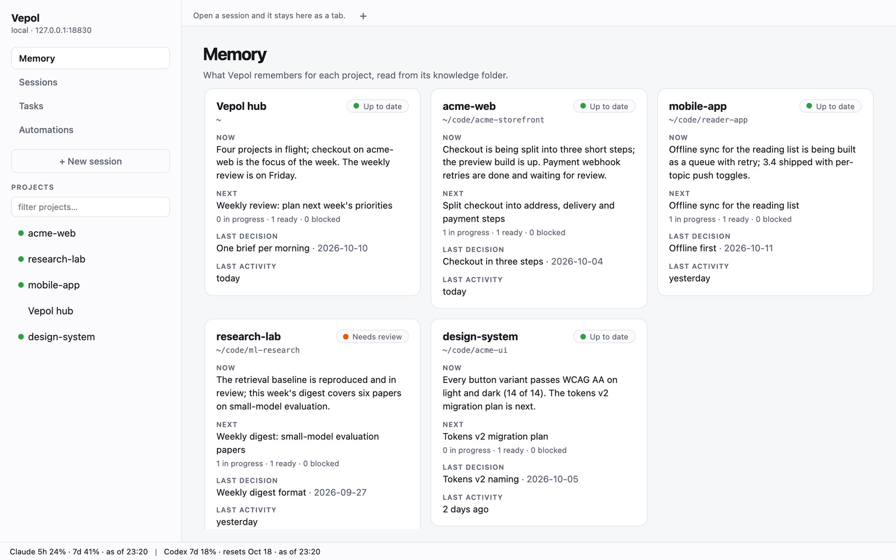
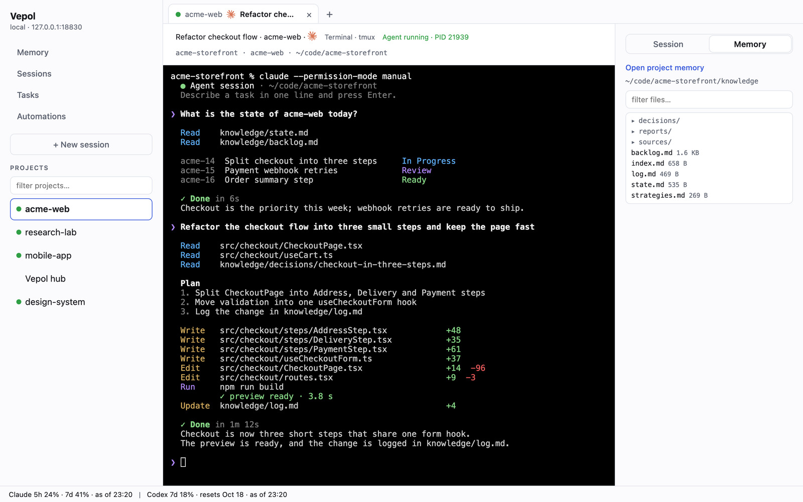

# Vepol features

Everything Vepol does, in one place: what each feature gives you, how to turn
it on and what it needs. The [README](../README.md) is the short tour. This page
is the reference.

**How to read this page.** Every feature says where it stands:

| Status | What it means |
|---|---|
| **Works after install** | Ready as soon as `./install.sh` finishes. |
| **Turn on at install** | Runs on its own once you answer yes to *Install scheduled tasks?* during install. |
| **Needs your account or source** | Needs something of yours: a Telegram bot, Gmail in Codex, Google Calendar in Claude Code, a health file. |
| **Switch on when you want it** | Ships turned off. A short setup turns it on, often one line in `processes.yaml`. |
| **Experimental** | Ships as code you can run, but needs manual setup, has known gaps and may change. |
| **Direction** | Where Vepol is heading. Not built yet. |

Commands assume `~/knowledge/bin` is on your `PATH`
(`export PATH="$HOME/knowledge/bin:$PATH"`) and that you installed the Python
packages from `requirements.txt` ([Getting started](getting-started.md)). This
page describes the `main` branch, which a fresh clone gives you. Features marked
*new on `main`* are not in a tagged release yet (the latest is 1.1.1).

## Contents

- [What it does for you](#what-it-does-for-you)
- [It remembers](#it-remembers)
- [It runs your day](#it-runs-your-day)
- [It keeps you sharp](#it-keeps-you-sharp)
- [People and ideas](#people-and-ideas)
- [Vepol Desktop](#vepol-desktop)
- [It stays yours](#it-stays-yours)
- [Under the hood](#under-the-hood)
- [Experimental](#experimental)
- [Direction](#direction)
- [Read next](#read-next)

## What it does for you

- **[It remembers.](#it-remembers)** Every project keeps one memory in plain
  Markdown: where things stand, what happened, what was decided and what is
  next. Every agent you open starts from it and writes back to it.
- **[It runs your day.](#it-runs-your-day)** A one-minute brief in Telegram
  each morning, with your meetings, every new email, ready ideas, risks and,
  if you feed it your watch data, how you slept. An optional audio version. A
  dialog that turns the brief into an agreed plan. A short retro each evening.
- **[It keeps you sharp.](#it-keeps-you-sharp)** A daily review of new arXiv
  papers in your language, research on demand, and an optional Money Radar that
  scouts paying opportunities with several agents at once.
- **[It keeps people and ideas.](#people-and-ideas)** A card per person with
  follow-up reminders. Ideas captured in seconds, triaged, and promoted to tasks
  or calendar blocks.
- **[One window for all of it.](#vepol-desktop)** Vepol Desktop shows every
  project's memory, today's plan, your agents in real terminals, every task and
  every routine with its health.
- **[It stays yours.](#it-stays-yours)** It runs on your Mac, in Markdown you
  can read, edit and `grep`, with any agent vendor. Every routine leaves a
  record.

## It remembers



### One memory per project

Each project gets a `knowledge/` folder next to its code:

| File | What it keeps |
|---|---|
| `state.md` | Where things stand right now. |
| `log.md` | What happened, one dated entry per event. |
| `backlog.md` | The task board ([how it works](#task-board)). |
| `escalations.md` | What waits for your decision. |
| `incidents.md` | What broke, why, and the rule that prevents it next time. |
| `strategies.md` | Your working assumptions, a template you fill in. |
| `daily/`, `reports/`, `sources/` | Session notes, reports and saved sources. |

Decision records you or your agents keep in `knowledge/decisions/` show up on
the project screen in Vepol Desktop. The hub, `~/knowledge`, keeps the same files for
work that spans projects and links every project's folder under
`~/knowledge/projects/<slug>`.

- **Status:** works after install.
- **Add a project**, any of three ways:
  - Open Claude Code in the project folder and type `/init-kb`. Claude proposes
    a name, a category and a description, asks you, then creates the folder.
  - From a terminal: `new-wiki <path-to-project> [slug] [category] [description]`
    (category: `lab`, `order`, `pet`, `job` or `personal`, the default).
  - In Vepol Desktop: **+ New session**, then **Add project…**.

  Each way creates `knowledge/`, adds it to the project's `.gitignore`, links it
  into the hub and lists it in `~/knowledge/registry.md`. Once that file is
  generated by `kb-rebuild-registry`, `new-wiki` leaves it alone and prints the
  entry to append to the migration table instead. A project that already has
  its own `AGENTS.md` keeps your text; `new-wiki` appends one short Vepol block
  that tells Codex and other agents to load the startup context.

### Every agent starts from it

Every Claude Code session in a project or the hub starts with a startup bundle:
the agent card, `state.md`, the recent `log.md`, active tasks (Ready, In
Progress, Blocked and Review, then the first 10 Backlog items), open
escalations, incident prevention rules, recent session notes and the list of
agent CLIs installed on this Mac. Codex, Antigravity, Hermes and other agents
get the same bundle: the project's `AGENTS.md` tells them to run
`~/knowledge/bin/kb-session-start --print --cwd "$PWD"` (Antigravity reads it
with `agy --add-dir <path>`). In a project with no memory yet, Claude Code is
told it can set one up with `/init-kb`, but only when you ask.

- **Status:** works after install.
- **Turn on:** the installer adds the Claude Code hooks when it creates
  `~/.claude/settings.json`. If you already had that file, the installer offers
  to add them (for `./install.sh --apply`, set `VEPOL_MERGE_HOOKS=1`). You can
  also run `~/knowledge/bin/kb-claude-hooks --apply` (*new on `main`*): it
  keeps a dated backup, adds only the missing hooks and keeps every other
  setting. `~/knowledge/bin/kb-claude-hooks --check` tells you whether they
  are there.
- **Needs:** Claude Code for the hooks. Any agent that reads `AGENTS.md` for the
  rest.

### Session capture

After each Claude Code session in a project, a model writes the session's
decisions, lessons and action items to `knowledge/daily/YYYY-MM-DD.md` and adds
one dated line to `log.md`. Token-shaped secrets are redacted. A summary that
fails is kept and retried at a later session end, and the next session start
tells you how many are waiting (*new on `main`*).

- **Status:** turn on at install. Answer yes to *Install claude-memory-compiler
  for automatic session capture?*, or run
  `VEPOL_ENABLE_MEMORY_COMPILER=1 ./install.sh --apply`.
- **Needs:** `uv`, a signed-in Claude Code, and network for the one-time clone of
  [claude-memory-compiler](https://github.com/coleam00/claude-memory-compiler).
  It captures Claude Code sessions in projects that have a `knowledge/log.md`.
  Hub sessions and other agents are not captured.

### Search

`kb-search "query"` searches the hub and every linked project in one pass: notes,
logs, reports, saved sources, briefs, session notes and ideas, plus the text
digests in `reports/`. Narrow it with `--project <slug>` or `--hub-only`. Secret
files (`.secrets`, `.env`, token files) are never searched. Pages link with
`[[wiki-links]]`, so you can also browse the hub in Obsidian or any Markdown
editor.

- **Status:** works after install.
- **Needs:** ripgrep (it falls back to `grep`).

### Health check

`kb-doctor` checks the knowledge base: the registry and project links, how fresh
each `state.md` is, open incidents and task-board hygiene.
`kb-doctor install-health` checks the install itself: hooks, scheduled tasks,
session capture, required tools and the Python packages from
`requirements.txt`. The installer runs it at the end.
`kb-doctor graph-audit` lists pages that nothing links to. Add `--write` to
`kb-doctor` or `kb-doctor graph-audit` to queue the findings in
`pending-curation.md`.

- **Status:** works after install.

### Try it on sample data

`kb-demo` runs a `kb-*` command against a private copy of an invented hub that
ships with the repo, so your own hub and your clone stay untouched:

```bash
kb-demo search "renewal"
kb-demo brief                  # prints a brief and sends it nowhere
```

- **Status:** works after install.
- **Needs:** `kb-demo brief` needs a signed-in Codex or Claude Code.

## It runs your day

Your routines run on their own once you answer yes to *Install scheduled tasks?*
(or install with `VEPOL_ENABLE_LAUNCHD=1 ./install.sh --apply`). The whole
schedule lives in one readable file, `~/knowledge/personal/processes.yaml`
([how it works](#background-processes-runtime)). The brief, the retro and the
digests arrive in Telegram.

### A default day

- **06:30.** The nightly refresh of each project's `state.md`, once you set up
  the project map ([details](#nightly-knowledge-refresh)).
- **07:15.** A mail check, then the morning brief, then the arXiv digest, then
  the morning audio.
- **20:30.** A mail check, then the evening retro, then the evening audio.
- **Off until you switch them on:** people reminders at 09:00, Money Radar,
  people proposals.

`kb-tick` checks the schedule every 15 minutes, so each step starts within about
15 minutes of the one before. Change a time by editing its `when:` line in
`processes.yaml`.

### Telegram

Telegram is where the brief, the retro, the digests and the people-review
buttons arrive.

- **Status:** needs your account or source.
- **Turn on:**
  1. Create a bot with [@BotFather](https://t.me/BotFather) and copy its token.
  2. Send your bot any message. Then open
     `https://api.telegram.org/bot<token>/getUpdates` and copy the number at
     `"chat":{"id": ...}`.
  3. Put both in `~/knowledge/personal/.secrets`, which the installer creates
     with mode 600:

     ```text
     TELEGRAM_BOT_TOKEN=<token from BotFather>
     TELEGRAM_CHAT_ID=<your chat id>
     ```

  Until both are set, the brief, the retro and the digests are still written to
  `~/knowledge`, just not sent. The rest of the day still runs.
- **Good to know:** use a different bot from the one in Claude Code's own
  Telegram plugin (`~/.claude/channels/telegram/.env`). Two listeners on one bot
  steal each other's messages. Optional `USER_NAME` and `USER_CITY` lines in the
  same file personalize the brief.

### Morning brief

Every morning, shortly after the 07:15 mail check, a brief you can read in a
minute:

- the focus of the day;
- a timed plan built around today's meetings;
- one to three actions, each with a "done when";
- the decisions only you can make;
- every new email, one line each, saying whether you need to act;
- up to three ready ideas with their next step;
- what changed, and the risks, including open escalations.

Sections with nothing to report shrink into one "quiet" line. The brief is
written in your language, set in `~/knowledge/personal/profile.yaml`
(`language: en`). Each brief is saved to `~/knowledge/briefs/<date>.md` before
it is sent. Long briefs go out in parts, tracked one by one, so a crash or a
network drop never sends a part twice. The evening retro joins the
same file, so each day keeps one record.

- **Status:** turn on at install.
- **Run it by hand:** `kb-brief` prints one line saying where the brief was
  saved and whether it was delivered. `KB_BRIEF_DRY=1 kb-brief` prints the brief
  instead of sending it (it is still saved as today's brief). A manual run
  before 06:00 is a preview with its own file, so the scheduled brief still goes
  out. If Telegram was not set up, the day file says `delivery: not_configured`;
  run `kb-brief` again once it is set up: it sends the saved brief without a
  new model call. When no AI agent answers, `kb-brief` exits 1, saves no brief
  and names the reason for each agent it tried (for example "Codex: not
  installed."). The reason goes to Telegram, at most once a day, when Telegram
  is set up; a manual run, or any run without Telegram, also prints it.
  `kb-brief --help` lists the settings.
- **Needs:** a signed-in Codex or Claude Code ([failover](#codex-and-claude-failover)),
  and Telegram for delivery.

### Mail summaries

At 07:15 and 20:30 a read-only reader picks up to 25 new inbox threads through
Codex's Gmail plugin. Each gets a label (needs reply, calendar, waiting,
receipt, alert, newsletter, FYI, noise), an urgency and a one-sentence summary.
The brief lists every email. The retro lists what still waits for a reply.

Vepol never drafts, sends, labels or deletes mail. It stores no email body or
recipient list. The summary file keeps the sender's name, the subject and the
one-sentence summary. Sender names and addresses go only to a separate private
file that the [People](#people) module reads. Email text is treated as data,
never as instructions.

- **Status:** turn on at install, and needs your account or source.
- **Turn on:** both mail steps are on in the default schedule but read nothing
  until Codex can reach Gmail. Install Codex, sign in and connect its Gmail
  plugin. Until the first successful read, the brief and the retro leave mail
  out entirely.
- **Turn off:** set `enabled: false` on `mail-morning` and `mail-evening` in
  `processes.yaml`. The brief and the retro then run at 07:15 and 20:30.
- **Needs:** the Codex CLI with its Gmail plugin. Vepol looks for Codex at
  `$KB_CODEX_BIN`, `~/.local/bin/codex`, your `PATH`, `/opt/homebrew/bin/codex`
  and `/usr/local/bin/codex`. It skips the copy inside the Codex app bundle.

### Calendar and follow-ups

Today's meetings land in the brief's plan at their exact times, and the nearest
hard deadline is flagged. Follow-up reminders are proposals until you approve
them:

```bash
kb-followup propose --summary "Check in with the design team" --when "tomorrow 09:00"
kb-followup list
kb-followup approve <id>       # the only step that writes to Google Calendar
```

Approved reminders show up in the brief. `kb-task "..." --due "..." --calendar`
proposes a reminder for a new task the same way.

- **Status:** needs your account or source.
- **Turn on:** connect Google Calendar in Claude Code (its Google Calendar
  connector). `KB_CALENDAR_DISABLE=1` turns calendar access off.
- **Needs:** Claude Code with Google Calendar connected.

### Sleep and health in the brief

If your own sync writes a small JSON file each morning, the brief opens with a
Body section: last night's sleep, HRV against your own baseline, resting heart
rate, Body Battery at wake when your source has it, and yesterday's steps and
workouts. It turns these into one suggestion for the day (train, take it easy,
or go to bed earlier), and the suggestion also lands in the day plan. Late or
missing data gets one honest line instead. Old numbers are never passed off as
today's. Garmin is the worked example: its numbers map field by field.

- **Status:** needs your account or source. *New on `main`.*
- **Turn on:** add `KB_HEALTH_METRICS=<folder>` to
  `~/knowledge/personal/.secrets`. The folder holds
  `morning/<YYYY-MM-DD>.json` in the `health-morning/v1` format. Two more
  settings make the scheduled brief wait for your sync. The format and the
  settings are in [Health in the morning brief](health-in-the-brief.md).
- **Needs:** your own export or sync that writes the file. Vepol ships no Garmin
  or Apple Health connector.

### Evening retro

After the 20:30 mail check, a short retro (under 900 characters) in six parts:
what closed today, taken from the logs rather than the plan; how heavy the
backlog is; what needs attention; one insight; how well the morning brief (and
your agreed day plan, if you made one) matched the day, with one improvement for
tomorrow; and one question before sleep. Mail still waiting for a reply shows
up too. The retro is saved to the same day file as the brief.

- **Status:** turn on at install.
- **Needs:** a signed-in Codex or Claude Code, and Telegram for delivery.

<a id="morning-audio-routes"></a>
### Audio digests

The morning digest joins the finished brief (with its Body section), the arXiv
report and the Money Radar digest, in that order. Vepol adds no model pass of
its own. The evening digest uses the retro. You pick one of two routes:

- **NotebookLM** (the default). The text goes to a NotebookLM notebook, which
  makes its own Audio Overview from it. The audio stays in NotebookLM. Nothing
  is sent to Telegram.
- **Local Qwen voice.** A Qwen3-TTS model on your Mac reads the text word for
  word, and the MP3 goes to Telegram. The model loads for one render and exits;
  nothing stays running.

```bash
# NotebookLM (the default route)
notebooklm login
kb-digest-migrate --file ~/knowledge/personal/processes.yaml --audio-backend notebooklm

# Local Qwen voice, MP3 to Telegram
kb-tts-install
kb-digest-migrate --file ~/knowledge/personal/processes.yaml --audio-backend local_qwen
```

- **Status:** turn on at install. A new interactive install asks which route
  you want. `./install.sh --apply --audio-backend notebooklm|local_qwen` sets it
  too.
- **Good to know:** `kb-tts-render --check` says whether the local voice is
  ready. To redo today's digest, run `kb-morning-digest --force` (evening:
  `kb-morning-digest --period evening --force`). If you switch on Money Radar
  later, run `kb-digest-migrate --file ~/knowledge/personal/processes.yaml` once
  more so the morning digest waits for it.
- **Needs:** for NotebookLM, the `notebooklm` CLI from the notebooklm-py
  package (`kb-cli-offer --list` shows how to install it) and a NotebookLM
  login. For the local voice, an Apple Silicon Mac, `uv`, `ffmpeg`, about 10 GiB
  of free disk for the model, and Telegram.

<a id="daily-plan"></a>
### Plan my day

In Vepol Desktop, the Today card on the Memory screen shows today's plan: goal,
outcomes, time blocks and status. **Plan my day** opens the agent you pick in
the app's terminal. It reads the brief, your goals and your calendar, proposes a
plan and saves every change as a new version with `kb-dayplan`. You confirm the
plan in your own words. Only when you ask separately are the agreed blocks
written to Google Calendar. Vepol then reads the calendar back and tells you
exactly what is there. If a busy event overlaps an agreed block, nothing is
written. The evening retro compares your day with the confirmed plan.

- **Status:** works in [Vepol Desktop](#vepol-desktop) once you build it. *New
  on `main`.*
- **Without the Desktop:** ask any agent to follow the planning prompt. Its path
  is in the output of `kb-dayplan show --json`.
- **Needs:** an agent CLI. The calendar step needs Google Calendar connected in
  Claude Code.

### Escalations

When an agent or a routine cannot go on without you, it adds an entry to
`escalations.md`. Open entries appear at the start of every agent session and in
the morning brief's risks line.

- **Status:** works after install.

## It keeps you sharp

### arXiv learning digest

Each morning after the brief, up to three new arXiv papers on AI agents and the
topics around them: memory and retrieval, tools and MCP, reasoning, evaluation,
local models and safety. Vepol reads the full paper when it can and explains
each one in your language: why it was picked, what was studied, how, what was
found, and a short glossary. Telegram gets a header and one message per paper.
The full report is saved to
`~/knowledge/reports/learning-arxiv-summary-<date>.md`. On a day with no new
papers you get one short notice.

- **Status:** turn on at install.
- **Settings** (all optional), in `~/knowledge/personal/daily-research.yaml`:
  - `max_papers: 2` for fewer papers (1 to 3);
  - `arxiv_categories: [cs.AI, cs.CL]` to change the categories (default
    `cs.AI`, `cs.LG`, `cs.CL`, `cs.CV`, `stat.ML`);
  - `focus_project` or `focus_context` to frame "why it matters" around one of
    your projects;
  - `social_check: grok` to add whether each paper is being discussed on X and
    Reddit (needs the Grok CLI; Grok runs with file writes and shell commands
    denied).
- **Needs:** Claude Code for the explanations (Codex is the fallback),
  `pdftotext` from poppler to read full papers (without it Vepol uses the
  abstract), and Telegram.

### Daily research

Research on demand, in two modes:

- `kb-daily-research --text-only` collects fresh AI-agent links from the
  OpenAI, Google and Anthropic news feeds, Hacker News, Reddit, GitHub and the
  day's arXiv picks, and sends up to eight of them to Telegram as a list.
- `kb-daily-research` builds a NotebookLM notebook on the topic and generates an
  audio recap in your language. This mode runs only by hand.

The topic is a curated radar over the AI-agent space. Pin your own with
`kb-daily-research --set-topic "..."` and go back to the radar with
`kb-daily-research --auto-topic`. A pinned topic is researched in the NotebookLM
mode. The link list comes only from the radar, so while a topic is pinned,
`--text-only` sends no links.

- **Status:** switch on when you want it. To get the link list daily, add this
  block to `processes.yaml`:

  ```yaml
  - id: research
    enabled: true
    when: after:learning
    run: kb-daily-research --text-only
    outputs: [telegram, file]
  ```

- **Needs:** network access and Telegram. The NotebookLM mode needs the
  `notebooklm` CLI and a NotebookLM login.

### Money Radar

Every day, several agents search the web at once for real money flows: what
people complain about and pay to fix. Codex, Claude Code, Grok and Antigravity
take part, whichever you have; a missing one is skipped. Vepol merges and ranks
their finds by rules, with no extra model pass, and ideas that several agents
found on their own rank higher. You get one find a day (two when the second is
strong), each labelled white (legal and mainstream), grey (legal but with a
named risk) or black (illegal: shown for awareness only, never with steps). Each find
comes with the money flow, rough numbers and proof links; white and grey finds
also say how to try them. The digest goes to Telegram and into the morning
audio.

- **Status:** switch on when you want it.
- **Turn on:**
  1. Describe yourself in `~/knowledge/personal/money-radar.yaml`:

     ```yaml
     location: Your city, country
     edge: your skills, languages, local network
     finds: 1
     lanes:
       - AI/automation services
       - marketplace & arbitrage plays
     ```

     `lanes` are interest hints, not limits.
  2. Set `enabled: true` on the `money-radar` block in `processes.yaml`.
  3. Run `kb-digest-migrate --file ~/knowledge/personal/processes.yaml` so the
     morning audio waits for the radar.
- **Needs:** at least one of Codex, Claude Code, Grok (`~/.grok/bin/grok`) or
  Antigravity (`~/.local/bin/agy`), each with its own login, and Telegram.
  Reports land in `~/knowledge/reports/money-radar/`.

## People and ideas

### People

One Markdown card per person, in `~/knowledge/people/`:

```bash
kb-contact add "Jane Doe" --email jane@example.com --met "conference panel"
kb-contact log <slug> "Talked about the pilot; she sends numbers on Friday"
kb-contact remind <slug> --in 2w
kb-contact due                       # follow-ups due in the next 7 days
kb-contact context jane@example.com  # a short "who is this" card before you reply
kb-contact enrich <slug>             # one-time public profile lookup
```

`kb-contact enrich` searches the web once through Codex and keeps a profile
only when it matches something you already know, such as the company, email
domain or role.

- **Status:** works after install.
- **Follow-up reminders in Telegram** (switch on when you want it): set
  `enabled: true` on `people-remind`. It runs at 09:00.
- **Proposals you approve with a tap** (switch on when you want it). New people
  from your mail senders, calendar attendees and private Telegram chats are
  proposed as cards. Each arrives in Telegram with buttons: Approve, Merge,
  Reject and Later, plus an optional web search once you approve. A new person
  from these sources gets a card only after you tap Approve. A new email address
  in your project logs gets a card right away, because you or your agents wrote
  it down. People you already know get a dated line on their card, never message
  text.
  - Run `kb-extract-people --hub ~/knowledge --init-watermarks` once, then set
    `enabled: true` on `people-extract`. Mail senders come from the
    [mail summaries](#mail-summaries).
  - Calendar attendees: set `enabled: true` on `calendar` after you connect
    Google Calendar in Claude Code.
  - Private Telegram chats: install Telethon
    (`python3 -m pip install --user 'telethon>=1.36,<2.0'`), put `TG_API_ID`
    and `TG_API_HASH` from [my.telegram.org](https://my.telegram.org) in your
    environment or in `~/.orchestrator/multibot.env`, run
    `kb-telegram-people --hub ~/knowledge --login` once, then set
    `enabled: true` on `telegram-people`. It records who wrote to you (names,
    usernames, phone numbers when Telegram shows them, message counts), never
    message text.
  - The buttons come from `kb-people-review-bot`, which starts with scheduled
    tasks and stays idle until `TELEGRAM_BOT_TOKEN` and `TELEGRAM_CHAT_ID` are
    set. `kb-contact push` sends waiting candidates by hand.
- **Needs:** the Python packages from `requirements.txt`; Telegram for
  reminders and review; Codex for `enrich` and mail senders. More in
  [People](modules/people.md).

<a id="idea-intake"></a>
### Ideas

A passing thought becomes a card you can triage, park, promote or close:

```bash
kb-idea capture "Offer a fixed-price audit package"
kb-idea triage <id> --priority P1 --next-action "Draft a one-page offer"
kb-idea promote <id> --create-task             # a Ready task on the hub board
kb-idea done <id> --outcome "Sold two audits in March"
```

Cards live in `~/knowledge/personal/ideas/`, and `kb-idea render` rebuilds the
dashboard, `~/knowledge/personal/ideas.md`. Triage marks an idea ready (material
ideas go to critique first) and checks the titles of your other cards for a
near-duplicate. Up to three ready or promoted ideas appear in the morning brief
with their next step. `promote --project <slug>` puts the task on a project's
board. To block time for an idea, propose a slot with
`kb-idea calendar propose <id> --title "..." --start <time> --end <time>`, then
`kb-idea calendar approve <id> <proposal-id> --apply` creates the Google
Calendar event and links it to the card. Nothing picks ideas out of your chats
on its own: run `kb-idea capture` or ask your agent to save the idea.

- **Status:** works after install.
- **Needs:** the `python-frontmatter` package from `requirements.txt`. The
  calendar step needs Google Calendar connected in Claude Code. More in
  [Idea Intake](modules/idea-intake.md).

## Vepol Desktop

A native Mac app, in [`face/`](../face/README.md), that shows all of Vepol in
one window and runs your agents inside it.

<picture>
  <source media="(prefers-color-scheme: dark)" srcset="readme/memory-dark.jpg">
  
</picture>

- **Memory.** The app opens on one card per knowledge base, the hub first, then
  the most recently active projects. Each card shows what is happening now, what
  is next, the last decision, the last activity and whether `state.md` is up to
  date or needs review.
- **Today.** The Today card shows your saved day plan, and **Plan my day**
  starts the planning dialog ([details](#daily-plan)). *New on `main`.*
- **Project screen.** One click on a project shows its state, its sessions, its
  task board, decisions, history, lessons and files.
- **Your agents in real terminals.** Claude Code, Codex, Antigravity (`agy`),
  Hermes, OpenCode or Grok runs as a normal interactive CLI inside the window,
  each session in its own tmux session. Run several sessions per project. Every
  open session is a tab, and your tabs come back after a restart.
- **Nothing stops when you quit.** Agents keep running when you close the app.
  Pick up any session from Terminal.app with the `tmux attach` command shown in
  the session's side panel.
- **Add project…** turns any folder, including a new one, into a Vepol project
  and starts a session there.
- **Sessions board.** Every session on a board with five stages (Queue,
  Research, Working, Review, Done), with drag and drop, search and a project
  filter. Cards show the agent's own session title and last message.
- **Tasks.** Every project's tasks in one table with search. Start an agent on a
  task, or close a task you no longer need, with Undo (*new on `main`*). Every
  change goes through `kb-board`.
- **Automations.** Every routine in `processes.yaml` with today's state and the
  reason, the last and next run, 14 days of history and the end of its output.
  *Failed in result* catches runs that exited cleanly but produced nothing
  usable.
- **Memory panel.** Next to the terminal, a read-only tree of the project's
  `knowledge/` folder with rendered Markdown.
- **Usage bar.** Your Claude 5-hour and 7-day limits and your Codex limits, read
  from local files. Codex works on its own. Claude needs `jq` and one line in
  your Claude Code status line script (see the [app's README](../face/README.md)).
- **Local only.** The app listens on 127.0.0.1 only and uses a per-launch token
  kept in memory, never on disk.

<picture>
  <source media="(prefers-color-scheme: dark)" srcset="readme/terminal-dark.jpg">
  
</picture>

### Build and open

The installer does not build the app. From the Vepol repo:

```bash
brew install python tmux
cd face
"$(brew --prefix)/bin/python3" -m venv .venv   # any Python 3.11 or later works
.venv/bin/pip install -r requirements.txt
./desktop/build.sh
open desktop/build/VepolDesktop.app
```

- **Status:** works after you build it.
- **Needs:** an Apple Silicon Mac with macOS 13 or later, the standalone Command
  Line Tools (`xcode-select --install`), Python 3.11 or later, `tmux` and an
  installed hub at `~/knowledge`.

### Try the demo

`./demo.sh` (in `face/`, after a build) opens the app on an invented company in
a throwaway copy, with its own port, state and tmux server. Your own projects,
sessions and `~/knowledge` stay untouched.

## It stays yours

### Your Mac, your Markdown

Everything Vepol knows lives in `~/knowledge` and in your projects' `knowledge/`
folders, as plain Markdown. Read it, edit it, `grep` it, open it in Obsidian.
Vepol hosts nothing. Your agents talk to their own vendors as they always do.

<a id="bring-your-own-ai-agent"></a>
### Any agent you choose

Vepol is not a model and not another chat. It is the shared memory, the
schedule and the working rules around the agents you already use: Claude Code,
Codex, Antigravity, Hermes, OpenCode, Grok, or any CLI agent that reads files
and follows `AGENTS.md`. Claude Code is required; the rest are optional.

- `~/knowledge/.active-roster.md` tells every agent which CLIs are installed on
  this Mac and when to use each one, so agents can call each other without you
  explaining. Add a CLI with one line in `~/knowledge/.orchestrator/cli-tools.tsv`.
  `kb-cli-offer --list` shows how to install the rest.
- Scheduled jobs fail over from Codex to Claude on their own
  ([details](#codex-and-claude-failover)).
- **Second opinions, by working rule.** For non-trivial development work, the
  installed `AGENTS.md` and the `development-loop` skill tell your agent to write
  a short spec, have one other agent check it against the code once, and wait
  for your approval before writing code. Your agents follow this rule; nothing
  in the code enforces it.

### A record of everything

Every routine leaves a dated trace. The brief and the retro are in
`~/knowledge/briefs/<date>.md`, reports in `~/knowledge/reports/`, saved sources
in `~/knowledge/sources/`, and a log per routine in `~/knowledge/logs/`. Agents
add dated entries to `log.md`. What broke goes to `incidents.md` with a
prevention rule; what needs you goes to `escalations.md`.

### Privacy

- Mail summaries store no email body, address or recipient list. Sender names
  and addresses go only to a separate private file for the People module.
- `~/knowledge/personal/.secrets` is mode 600 and read as data, never run as
  shell code. Vepol never hands your Telegram token to a model or puts it on a
  command line.
- Session capture redacts token-shaped secrets.
- Vepol Desktop listens on 127.0.0.1 only.

More in [Security and privacy](security-and-privacy.md).

### Upgrade and uninstall

- `./upgrade.sh` checks out the newest release tag and re-runs the installer.
  Your data stays as it is. `./upgrade.sh --check` only reports. It moves to
  release tags, never to the tip of `main`, so on a clone of `main` the newest
  tag can be older than what you run.
- `./uninstall.sh` removes Vepol's command links, its Claude skills, its block in
  `~/.claude/CLAUDE.md` and the LaunchAgents made from its templates. Your hub
  stays. At the end it lists what it leaves in place on purpose, such as the
  hooks in `~/.claude/settings.json`, session capture and the local voice, and
  how to remove each. Options: `--dry-run`, `--yes`, `--backup-user-data`.

### License

Vepol is source-available under [FSL-1.1-MIT](../LICENSE). Personal use and use
inside your company are free. Each release becomes MIT two years after it ships.
Details in the [commercial use FAQ](../COMMERCIAL.md).

### Dependencies

| What | Required | What it is for |
|---|---|---|
| macOS 13 or later | Yes | Scheduling and paths. macOS only for now. |
| [Claude Code](https://code.claude.com/docs/en/setup) (the `claude` command-line tool) | Yes | Install, startup hooks, `/init-kb`, failover. |
| git, ripgrep, bash 5+ | Yes | Install, `kb-search`, scripts. |
| Python 3.10+ | Yes | Every Python `kb-*` command and the startup hook. |
| Python packages in `requirements.txt` | For people and ideas | Install with `python3 -m pip install --user -r requirements.txt`. |
| Telegram bot | For delivery | Brief, retro, digests, review buttons. |
| [Codex](https://github.com/openai/codex) CLI | Recommended | First choice for the brief and retro, mail reading, people lookup, second opinions. |
| NotebookLM CLI (`notebooklm`, from notebooklm-py) | For the default audio route | Audio digests, research notebooks. |
| `uv` | Optional | Session capture, the local Qwen voice. |
| `ffmpeg` | Optional | The local Qwen voice. |
| `pdftotext` (poppler) | Optional | Full-paper reading in the arXiv digest. |
| `jq` | Optional | The Claude Code status line. |
| Antigravity, Grok, Hermes, OpenCode | Optional | More agents for your sessions and for Money Radar. |
| Vepol Desktop | Optional | Apple Silicon, Command Line Tools, Python 3.11+, `tmux`. |

The installer checks the required tools and prints the exact install command for
anything missing. It never installs a package manager. Full list:
[dependency matrix](dependency-matrix.md).

## Under the hood

<a id="background-processes-runtime"></a>
### The schedule: `processes.yaml` and `kb-tick`

Every routine is one block in `~/knowledge/personal/processes.yaml`:

```yaml
- id: daily
  enabled: true
  when: after:mail-morning
  run: kb-brief
  outputs: [telegram, file]
```

Five fields are required: `id`, `enabled`, `when`, `run` and `outputs`. `when`
is a time (`"07:15"`), `after:<id>` or `on-demand`. An optional `timeout:` (60
to 7200 seconds) sets the routine's own time limit instead of the default 30
minutes.

`kb-tick` runs every 15 minutes. It starts each enabled routine once its time
comes, marks it done for the day only when it succeeds, and tries a failed one
again on the next tick. Once a routine succeeds, it does not run again that day.
`after:<id>` waits until that routine succeeds today. If that routine is
`mail-morning`, `mail-evening`, `learning` or `money-radar` and it is switched
off, the waiting routine follows the switched-off routine's own time instead;
if any other routine is switched off (for example `daily` or `retro`), the
routines after it do not run that day. If the
file has a mistake, `kb-tick` runs nothing and writes the reason to
`~/knowledge/logs/planner.log`. A missing file is recreated with the defaults.

The default schedule:

| `id` | When | What it runs | Default |
|---|---|---|---|
| `consolidate` | 06:30 | `kb-consolidate` | On |
| `child-rollup` | 07:00 | `kb-child-rollup` | On |
| `mail-morning` | 07:15 | `kb-mail-brief --period morning --write` | On |
| `daily` | after `mail-morning` | `kb-brief` | On |
| `learning` | after `daily` | `kb-learning-arxiv --text-only` | On |
| `morning-digest` | after `learning` | `kb-morning-digest` | On |
| `people-remind` | 09:00 | `kb-people-remind --horizon 0` | Off |
| `money-radar` | after `learning` | `kb-money-radar --text-only` | Off |
| `mail-evening` | 20:30 | `kb-mail-brief --period evening --write` | On |
| `retro` | after `mail-evening` | `kb-retro` | On |
| `evening-digest` | after `retro` | `kb-morning-digest --period evening` | On |
| `telegram-people` | after `retro` | `kb-telegram-people --hub ~/knowledge --quiet` | Off |
| `people-extract` | after `retro` | `kb-extract-people --hub ~/knowledge --no-llm --quiet` | Off |
| `calendar` | after `retro` | `kb-calendar-sync --days 2` | Off |
| `entity-rollup` | after `people-extract` | `kb-entity-rollup` | Off |
| `process-improve` | on demand | `kb-evolution --knowledge-path ~/knowledge parse-ledger` | Off |

Scheduled tasks install four LaunchAgents: `com.knowledge.tick` (every 15
minutes), `com.knowledge.planner` (00:05, writes the day's schedule to
`~/knowledge/logs/today-plan.json`), `com.knowledge.orchestrator-cycle` (07:30
and 20:45, [experimental](#multi-project-nightly-cycle)) and
`com.knowledge.people-review-bot` (the Telegram review buttons). The
Automations view in Vepol Desktop shows the same state as the logs.

### Codex and Claude failover

The brief, the retro and other model jobs run through `kb-orchestrator-run`. It
tries Codex first, then Claude Code. When a provider fails, the runner names the
failure (rate limit, sign-in, network, timeout, crash) and rests that provider
for a while. After a rate limit it waits until the reset time the provider
reports, or 30 minutes. After a sign-in failure it waits an hour, after a
network error about 10 minutes. An empty Codex answer counts as a failure. Every attempt goes to
`~/knowledge/logs/orchestrator-run.log`. This is the main reason your routines
keep arriving when one provider is down.

- **Order:** `KB_ORCHESTRATOR_BACKENDS=claude,codex` puts Claude first.
- **Models:** by default neither CLI gets a model flag, so each uses your
  account's default. Set `CLAUDE_MODEL` or `CODEX_MODEL` to pin one. For
  scheduled runs, put these settings in the `EnvironmentVariables` of the
  LaunchAgent plist.
- **Permissions:** both run unattended. Codex runs with its approval prompts and
  sandbox turned off, for every job. Claude is read-only unless the job passes
  `--allow-edits`: it may not use Bash, Edit, Write or NotebookEdit, even if
  your Claude Code settings allow them, and everything else follows your
  settings. With `--allow-edits`, which the project cycle's reports, the task
  executor and `kb-spawn-project` pass, Claude may edit files in the job's
  folders and run any shell command; the shell grant is not limited to those
  folders. The brief and the retro do not pass it.
- **Where Vepol finds them:** Codex at `$KB_CODEX_BIN`, `~/.local/bin/codex`,
  your `PATH`, `/opt/homebrew/bin/codex` or `/usr/local/bin/codex`. Claude at
  `$KB_CLAUDE_BIN`, your `PATH`, `~/.local/bin/claude`,
  `/opt/homebrew/bin/claude` or `/usr/local/bin/claude`. A `KB_CODEX_BIN` that
  points to nothing runnable switches Codex off.

The arXiv digest keeps its own order: Claude first, Codex as the fallback.

### Durable Claude runner

Claude jobs run under a detached worker that waits for the answer, however long
it takes. No timer kills Claude halfway through an answer. Runs are kept in
`~/knowledge/.orchestrator/claude-runs/`, and you can manage them:

```bash
kb-claude-run --list-running
kb-claude-run --attach <run-id>
kb-claude-run --cancel <run-id> --reason "no longer needed"
kb-claude-run --cleanup          # empties the output of finished runs older than 7 days
```

### Runtime registry

`kb-runtime-registry` shows which of your agent CLIs can work right now:
installed, signed in, within quota and answering. The default report never
spends quota; it uses what the failover runner already recorded.
`kb-runtime-registry --probe [runtime ...]` sends each CLI a known-answer check
and records the result. `--json` prints the same data for scripts. It refuses
to probe from inside an agent session.

### Task board

Each `knowledge/backlog.md` is a Markdown task board that every agent shares,
with seven columns: Backlog, Ready, In Progress, Blocked, Review, Done and
Cancelled. There is no database: the file is the board.

- `kb-task "text" [--project <slug>]` adds a task to the board's Backlog (the
  hub board by default) and prints one line with its id. `--json` prints only
  the board's JSON result, for scripts. The next session in that project or
  the hub lists it in its startup bundle.
- `kb-board` moves tasks by ID: claim (with a lease the agent renews), progress,
  request review, close, cancel and reopen. `kb-board list <path>` shows one
  board.
- Vepol Desktop's Tasks view shows every board at once.

<a id="nightly-knowledge-refresh"></a>
### Nightly state refresh

At 06:30 `kb-consolidate` reads what each project logged since the last pass
(`log.md` and the `daily/` notes) and asks Claude (Sonnet by default) for point
edits to the project's `state.md`. It applies only edits whose old text matches
the page exactly and whose new text cites a log or daily date. If the model
fails, the page gets a short block listing the newer log headlines instead, so it
still says what it is missing. Each run leaves a report with a diff and a backup
under `~/knowledge/.orchestrator/consolidate/`. At 07:00 `kb-child-rollup`
copies each sub-project's snapshot and latest log headlines into its parent's
`state.md`, with no model involved.

- **Status:** turn on at install. *New on `main`.*
- **Turn on:** the refresh covers the projects listed in
  `~/knowledge/hierarchy.yaml`, which a fresh hub does not have yet. Create it
  once:

  ```bash
  kb-rebuild-registry bootstrap   # writes a project table for you to review
  kb-rebuild-registry apply       # writes hierarchy.yaml and the managed registry.md
  ```

  After that, add each new project to that table and run
  `kb-rebuild-registry apply` again; `new-wiki` prints the entry to append to
  `~/knowledge/migration-2026-04-25.yaml`. Change a project's status in that
  table too, then run `apply`; a change made only in the project's README
  front matter is overwritten by the next `apply`.
  `bootstrap` is a one-time step and refuses to overwrite the table;
  `bootstrap --force` rebuilds it (keeping a `.bak-<date>-<time>` copy) but
  cannot read back a generated `registry.md`, so check every category, status
  and description afterwards.
- **Needs:** a signed-in Claude Code.

## Experimental

These ship as code you can run. Each one needs manual setup, has known gaps or
may change.

### Multi-project nightly cycle

At 20:45, each project you opt in gets an agent-written report: what got done,
planned against actual, escalations. The reports roll up from child to parent
into the hub log and today's daily note. The cycle then rereads its own output
on disk and records an incident if something it claims is missing. It also
drafts tomorrow's plan in `~/knowledge/daily-plan/<date>.md` from open backlog
items (`kb-orchestrator-cycle gen-plan` does this on demand). If you set the
plan's `approved_at:` line to a date and time before 07:30, the morning run
files each item into its project's backlog.

- **Turn on:** scheduled tasks load the LaunchAgent, which does nothing until
  you set up the project map: `kb-rebuild-registry bootstrap`, review the table,
  `kb-rebuild-registry apply` (skip both if you already did this for the
  nightly refresh), then `cycle_enabled: true` in a project's
  `knowledge/.orchestration.yaml` and `kb-rebuild-registry apply` again.
- **Known gap:** the morning step writes only to older one-line backlogs. It
  cannot file items into boards in the current `kb-board` format, which every
  new project uses.

### Auto-executor

`kb-execute-next <slug>` takes the first task marked `auto: true` in a project's
backlog, runs an agent on it, and then closes it, puts it back or escalates it,
based on the agent's final `OUTCOME:` line and a tamper check on the backlog.
You run it by hand; nothing schedules it. It works only with older one-line
backlogs, not with `kb-board` boards.

### Evolution loop helpers

`kb-evolution` checks hand-written self-improvement proposals against a ban
list and risk tiers, and keeps an append-only ledger. It never writes or applies
a change itself. Start with `kb-evolution --knowledge-path ~/knowledge init`,
then check a proposal with
`kb-evolution check-policy <proposal.md> --evaluator <identity>`.

<a id="multi-bot-agent-runtime"></a>
### Multi-bot Telegram runtime

Gives each project its own Telegram bot in a private group. Mention a bot, and
Claude Code or Codex starts in that project and posts the answer back. Loop
guards limit how often bots answer each other: a cooldown per chat, a cap on how
many bots one message starts at once, and an hourly quota. A run that stays silent
for 15 minutes is stopped; raise `watchdog_silence_sec` for agents that run long
jobs. The code marks this runtime as deprecated, and the installer does not set
it up.

- **Turn on:** install the extras
  (`python3 -m pip install --user 'telethon>=1.36,<2.0' 'python-dotenv>=1.0,<2.0'`),
  run `kb-multibot-setup`, install the supervisor LaunchAgent from
  `launchd/com.knowledge.multibot-supervisor.plist.template` by hand, then run
  `kb-multibot-add <bot token>` for each project. Step by step:
  [multi-bot runbook](multibot-runbook.md) and
  [design](methodology/multibot-agent-runtime.md).

> **Self-hosting only.** The runtime uses your own Telegram user session to watch
> the group and can add bots to it. Use it only in private groups you control,
> with the consent of everyone in them. Treat bot tokens, Telegram API
> credentials, session files and group IDs as secrets. Do not use it to join,
> watch, scrape or automate groups you are not authorized to.

### Chat with Claude Code from Telegram

`kb-channels-start` opens a Claude Code session in your hub with Claude Code's
Telegram plugin. While it runs, messages to that bot reach the live session and
Claude answers in the same chat. To keep it running in the background, the
LaunchAgent template `launchd/com.knowledge.channel-telegram.plist.template`
restarts the session after a crash and every four hours. The installer does not
load it.

- **Needs:** Claude Code's Telegram plugin, Bun, and a second bot whose token
  goes in `~/.claude/channels/telegram/.env` (the installer's Telegram question
  creates that file).

## Direction


*This picture shows where Vepol is heading. Of what it shows, mail sorting and
the plain-text record work today. Drafting replies, earned autonomy, an automatic
review gate and health-driven intensity are not built yet.*

- **Autonomy that grows with you.** Each kind of task would start supervised and
  earn more independence as your corrections drop. Today nothing measures your
  edits. What runs unattended is the fixed set of routines in `processes.yaml`.
- **Strategy that updates itself.** Each project has a `strategies.md`. Today you
  or your agent edit it by hand. A weekly re-check of its assumptions is planned.
- **Health that sets the day's pace.** Today the brief turns your health file
  into one suggestion. A plan that lightens itself after poor nights is the
  direction.
- **An automatic review gate.** Today the one-pass second opinion is a working
  rule your agents follow. Code that launches the reviewer and holds work until
  it answers is not built.
- **Pro modules.** Paid add-ons are planned. None ship today.

## Read next

- [What is Vepol](what-is-vepol.md): the longer "is this for me?" page.
- [Getting started](getting-started.md): install, step by step.
- [Health in the morning brief](health-in-the-brief.md), [People](modules/people.md)
  and [Idea Intake](modules/idea-intake.md): the modules in depth.
- [Security and privacy](security-and-privacy.md) and the
  [dependency matrix](dependency-matrix.md).
- The working method behind Vepol, in [`methodology/`](methodology/): the
  [development loop](methodology/development-loop.md), the
  [orchestrated knowledge base](methodology/orchestrated-knowledge-base.md),
  [KB authoring discipline](methodology/kb-authoring-discipline.md),
  [spec-driven workflow](methodology/spec-driven-workflow.md),
  [lightweight spec review](methodology/cross-agent-review.md) and
  [TRIZ for design](methodology/triz-for-design.md).
