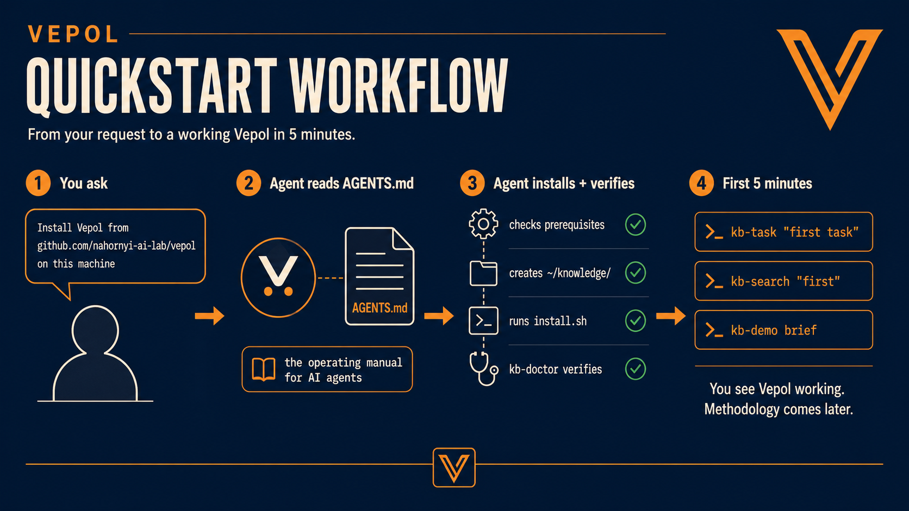
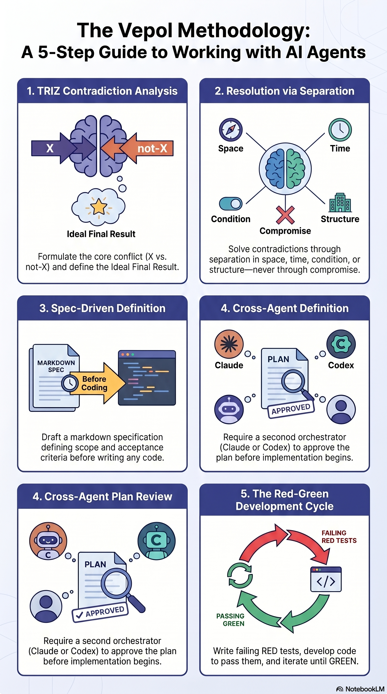
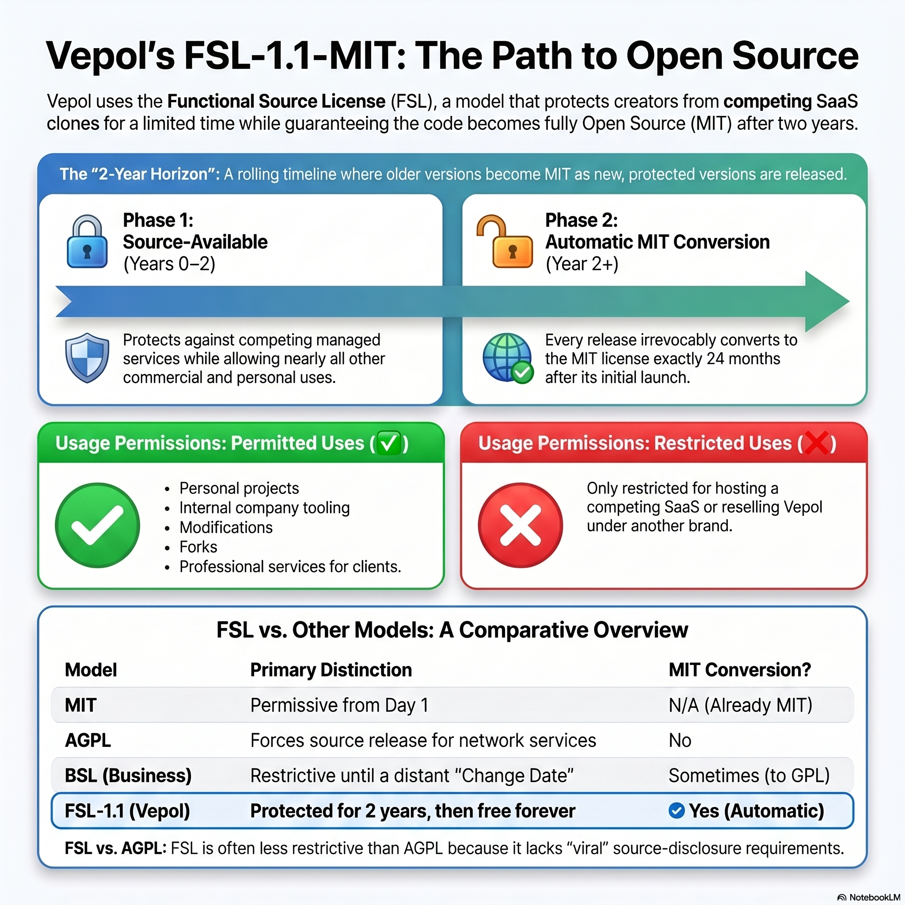

# Vepol visuals

> **Read this first.** These pictures, the [briefing](vepol-briefing.md) and the [mind map](vepol-mindmap.md) were generated from earlier versions of the Vepol docs. They show the product vision, so some of what they show is still direction. The [main README](../../README.md) and [docs/features.md](../features.md) describe what ships today.

Each entry below says where the picture is used, what it shows and where it differs from today's product.

## Cover

Used at the top of the [main README](../../README.md). It shows you, your agents and the shared Markdown trail between you; four autonomy stages from Day 1 to Month 6; three cards on the audit trail, cross-agent review and a self-updating strategy; and the license.

How it compares with today:

- **Audit trail.** Scheduled runs and your agents' work leave dated plain-text records: `log.md`, daily notes, briefs, run logs, escalations and incidents. Vepol does not version them. Make `~/knowledge` a git repository if you want history.
- **Cross-agent review.** For a non-trivial spec, your agent is told to get one review from a second agent before you approve it. Nothing reviews routine output automatically.
- **Self-updating strategy** is direction. `strategies.md` is a template that you and your agents fill in. Each evening the retro adds one line on how well the morning brief matched your day; that line is not one of the next brief's inputs yet.
- **The autonomy stages** are direction. No code tracks or advances them.
- **"Local-first"** means your files stay on your Mac. Routines send what they need to the AI services you connect. Claude Code is required; Codex and other agents are optional.

### Alternative cover

[`vepol-cover-notebooklm.png`](vepol-cover-notebooklm.png) tells the same story in a denser NotebookLM layout. No page uses it. Its autonomy stages are direction too: Vepol reads and sorts your mail, but it never answers mail through your draft folder. Its weekly self-updating strategy is direction, and its review gate is the same one-review rule as on the main cover.

## Autonomy growth

Used in the "Where Vepol is heading" section of the [main README](../../README.md) and in the "Direction" section of [docs/features.md](../features.md), both times captioned as direction. Panel by panel:

- **Day 1, "drafts emails".** Today the mail routine reads your inbox twice a day and lists every new email in your brief, marking the ones that need a reply. It never drafts, sends, labels or deletes anything; you write the replies. Mail needs scheduled tasks and Codex with its Gmail plugin.
- **Week 2, "classifies routine mail".** This happens from the first run: every email gets a category, an urgency and a one-line summary.
- **Month 2 and Month 6** are direction. No code writes Gmail drafts or measures what share of your routine runs on its own, so the 50% figure is not a measurement.
- **Audit trail.** Every routine run is recorded in plain text: the scheduler notes each run in `logs/planner.log`, the main routines keep their own logs in `logs/`, and the brief and the retro are saved in `briefs/<date>.md`. Not every action goes to `log.md` or `escalations.md`.
- **Cross-agent review gate.** A rule your agents follow for non-trivial specs, not an automatic check between Claude and Codex.
- **Health and goal alignment** is direction. Today the brief reads a daily health file from your own sync and, after a bad night, suggests rest or an earlier bedtime. Nothing lowers the system's workload automatically.

## More pictures

No page uses these five pictures at the moment. Each entry says what the picture shows and how it compares with today.

### Visible discipline

Its five cards, compared with today:

1. **Memory updates itself.** True when you turn on session capture at install (it needs `uv`). When a Claude Code session ends, its decisions, lessons and action items go to the project's `knowledge/daily/<date>.md`, with a pointer line in `log.md`. Moving a lesson on into `concepts/` is up to you and your agents.
2. **The coordination triad.** True: every project gets `backlog.md`, `escalations.md` and `incidents.md`.
3. **Strategy re-examined weekly** is direction. `strategies.md` is a template; nothing rereads or rewrites it on a schedule.
4. **Cross-agent review gate.** A rule, not a gate in code: for a non-trivial spec your agent gets one review from a second agent, and then you approve.
5. **Every event as a log entry.** Every scheduled run is logged, and agents that follow the contract write their decisions to `log.md`. `grep` finds whatever was written down.

### Comparison with a typical chatbot

The memory, context, tasks and transparency rows hold today. Four rows need a qualifier:

- **Decisions and lessons** are extracted automatically only when session capture is on.
- **Proactive** means your scheduled routines (morning brief, evening retro, digests) arrive without a prompt once you turn on scheduled tasks at install.
- **Cross-review** is the one-review rule for non-trivial specs.
- **Taking on more of your routine each day** is direction.

### Quickstart

The agent path now starts from [`SETUP.prompt.md`](../../SETUP.prompt.md). You paste that prompt into Claude Code or Codex. The agent reads `VERSION`, `README.md` and `AGENTS.md`, checks your Mac with `./install.sh --probe --json`, shows you a plan, asks before each step, runs the installer and verifies the result. The commands in the last panel work as shown once `~/knowledge/bin` is on your `PATH`; the installer does not add it, so until then type the full path, such as `~/knowledge/bin/kb-task`.

### Architecture

It shows the model behind Vepol's name: you, your agents and the Markdown knowledge base that binds them. It also shows the scripts and skills, the LaunchAgents, the project template, and the line between files Vepol manages (replaced on upgrade) and files that are yours (never touched). That line is now drawn by `~/knowledge/.orchestrator/install-manifest.json`, not by a `.managed.yaml` file. The repository panel at the lower right is about how the project's own code is organized; you can skip it.

### Methodology

It shows the working method: name the contradiction, resolve it by separation, write the spec before the code, get the spec reviewed, then write failing tests and make them pass. One step works differently today: a second agent reviews the spec once and answers `GO`, `QUESTIONS` or `BLOCK`, and then you approve it. The reviewer does not approve the plan. Step 4 appears twice in the picture by mistake. The [development loop](../methodology/development-loop.md) has the full process.

## License model

No page uses it. It matches the license: personal use, internal company use, modifications, forks and professional services for clients are allowed; a competing hosted service or a rebranded resale is not; and each release becomes MIT two years after it is published. Details: [LICENSE-FUTURE.md](../../LICENSE-FUTURE.md) and [COMMERCIAL.md](../../COMMERCIAL.md).

## Mind map and briefing

- [vepol-mindmap.md](vepol-mindmap.md) is a Mermaid mind map of Vepol's concepts. GitHub draws it inline. [vepol-mindmap.json](vepol-mindmap.json) holds the same tree for mind-map tools.
- [vepol-briefing.md](vepol-briefing.md) is a one-page summary of the vision.

Both start with a note on what has changed since they were generated.

## How these were made

The cover and the visible-discipline, comparison and quickstart pictures were made with ChatGPT image generation. The other pictures, the mind map and the briefing were made with [Google NotebookLM](https://notebooklm.google.com/) through the [notebooklm-py](https://github.com/teng-lin/notebooklm-py) command-line tool, with this repo's public docs as sources. They are regenerated by hand, so they can lag behind the docs.

## License

The files in this folder are covered by the same [FSL-1.1-MIT](../../LICENSE) terms as the rest of Vepol. The NotebookLM pictures carry a small NotebookLM mark in the bottom-right corner; keep it if you reuse them.
